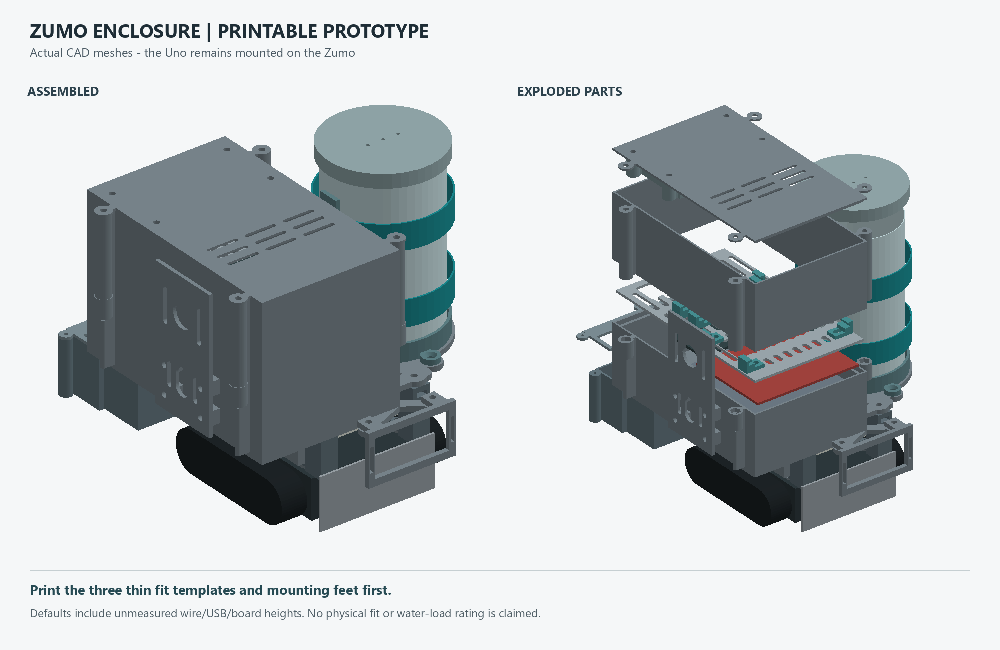
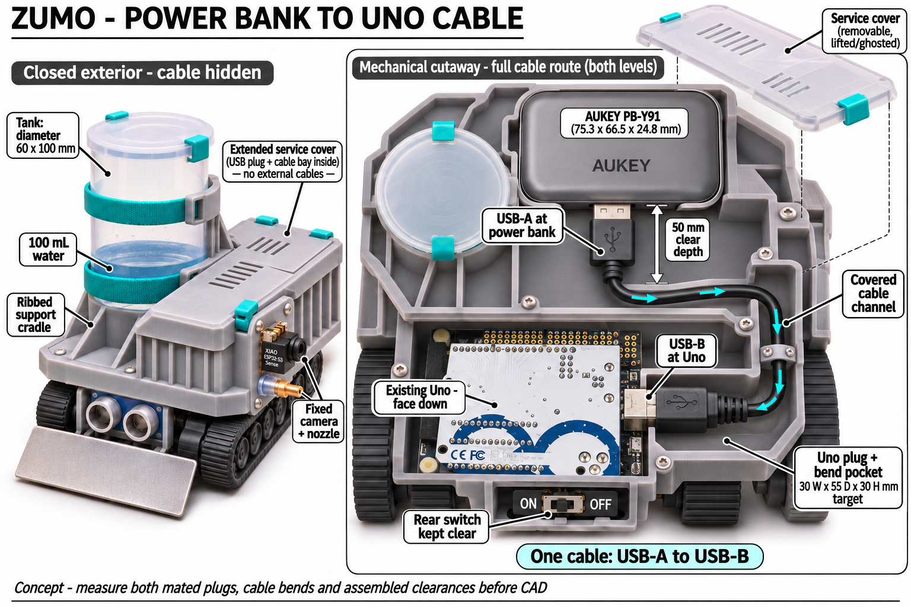

# Zumo enclosure — printable prototype

**Actual CAD and STL package, 17 November 2026:**
[Download the printable prototype](cad/zumo-enclosure-printable-prototype-v1.zip) ·
[Print and assembly guide](cad/README.md) ·
[Parts and quantities](cad/PRINT_MANIFEST.md) ·
[Editable parameters](cad/parameters.json) ·
[OpenSCAD model](cad/zumo_enclosure.scad).

The Uno remains attached to the Zumo, with its rear-soldered wires preserved.
The model includes separate chassis feet, a wire guard, both USB plug pockets,
a covered cable route, an original rear-switch access tunnel, a bottle cradle,
controller trays and one fixed camera/nozzle plate. Print the **three thin fit
templates and four mounting feet first**. The reference mounting pattern is
55 mm front / 50 mm rear / 63 mm row pitch; the actual robot remains unchecked.

All 22 STL models pass closed-solid and export/reopen checks. The default
assembly has no detected printed-part, reference-component or reserved USB/
header-envelope overlaps. This verifies the nominal digital geometry only.
Actual connector, wire, assembled-board, pump and mounting clearances need
checking. See [validation data](cad/validation.json).

The complete printed assembly envelope is approximately **164.5 x 184.5 x
142.2 mm**, including projecting brackets/ducts, excluding hardware and actual
components. This supersedes the earlier 155 x 135 mm planning footprint.
The full-solid plastic estimate is **269.35 g**, excluding hardware, electronics,
water and reference components. Actual slicer mass and loaded driving capacity
remain unverified; this is a substantial payload for this base.

## Earlier concept study

The v4-v6 material below records the earlier image-based layout. The CAD guide
above governs the current prototype, including its 70 x 50 x 30 mm bank plug
bay and the default heights/positions explicitly marked as assumptions.

Updated **17 November 2026**. This iteration uses the user's supplied component
outlines, the approximately 60 mm diameter cut-bottle tank, 100 mL water load,
hidden-wiring requirement and confirmed **rear** power-switch location.

**Latest USB correction:** show the complete cable to the Uno, with a full
mated USB-A plug at the bank, a covered internal route and a full mated USB-B
plug at the existing Uno socket. The current v6 mockup reserves a separate
Uno-end plug/bend pocket. The **155 x 135 mm main-carrier target** is not a
verified complete outer-case footprint; its local USB cover may need extending.

[Full-size mockup](enclosure-concept-v6-uno-cable.png) ·
[Dimensions and packing data](component-dimensions-v6.json) ·
[Load and fit assessment](load-and-fit-v4.md) ·
[Built-in Imagegen prompt](imagegen-prompt-v6.txt) ·
[Prior power-bank bay detail](enclosure-concept-v5-usb-clearance.png)

The layout is proposed. The component reference dimensions and rear-switch
requirement are user inputs; complete fit, mass, stability and mounting strength
have not been verified. The rendered panels are schematic, not a drill template.

## Current requirements

- Retain the photographed Zumo Shield/face-down Uno, original front blade and
  tracks. The user's compatible Uno and shield revision need physical checking.
- Keep the **existing small slide switch at the back**. Provide direct rear
  finger/tool access without removing the bottle or relocating the switch.
  Do not replace it with a case-mounted rocker or put a power switch at the front.
- Hide the electrical leads, USB plugs, adapters and spare cable inside removable
  covers. Preserve a relaxed loop above the existing Uno solder joints.
- Use the intact gray AUKEY PB-Y91 and account for its two built-in USB-C cables,
  additional USB plugs actually inserted into its output ports, plug/adapter
  bodies and cable bends. The photos do not establish adapter identity or
  electrical compatibility.
- Keep camera and nozzle on **one rigid right-side bracket**, lens above nozzle,
  facing the same direction. No pan/tilt, swivel or servo. Retain USB access and
  route sensor wires/tubing behind the bracket into covered channels.
- Keep the front ultrasonic and underside line-sensor view clear.
- Use the current cut bottle, about diameter 60 x 100 mm, with an intended
  100 mL water fill. The earlier small rectangular tank CAD is superseded for
  this Zumo arrangement.
- Include room for the MSP430, FireBeetle and mini breadboard. Board heights,
  actual breadboard dimensions and plugged-in connector envelopes remain unknown.
- The desk Pico, laptop and dock MSP430/Booster stay off the car under the existing
  project plan.

## Component sizes supplied by the user

All dimensions are millimetres. PCB outlines do not include plugged-in cables.

| Item | Reference dimensions | Status and remaining check |
| --- | --- | --- |
| MSP430 MSP-EXP430F5529LP | 73.66 x 58.42 PCB | User reports TI reference CAD; verify the actual Rev 1.8 outline, hole locations, header/USB/jumper heights. Assembled height unknown. |
| FireBeetle DFR0478 | 58 x 29 PCB | Assembled height and connectors unknown. |
| AUKEY PB-Y91 | 75.3 x 66.5 x 24.8 body | Also published by [AUKEY](https://aukey.sg/products/aukey-pb-y91-swivel-mini-10000-mah-power-bank-with-dual-built-in-usb-c-cables). Add port, cable-root, plug and retention clearance. Mass unknown. |
| Uno R3 | 68.6 x 53.4 reference PCB | User's compatible board may differ. It remains installed in the base. |
| Zumo for Arduino | Approximately 98 x 98 x 39 overall reference | User reference includes Arduino. Actual stack, switch position coordinates and track contact polygon remain to measure. |
| Cut bottle | Approximately diameter 60 x 100 high | User measurement; empty-bottle mass, internal shape and neck/rim details unmeasured. |
| Water | 100 mL, approximately 100 g | Intended working fill; add bottle, lid, hose and pump mass separately. |
| Mini breadboard | Not yet measured | Previous 47 x 35 was a planning allowance only, not a measured size or an approved component envelope. |

Pololu's [bare chassis reference](https://www.pololu.com/product/1418/specs)
is a different assembly envelope from the user's Uno-equipped overall reference.
Neither figure supplies the actual contact polygon or mounted clearances.

## Revised arrangement

The previous rear tank pod is replaced by a **low left bottle cradle** and a
**low right power-bank tray**, both supported from a common ribbed chassis
carrier. The lighter electronics sit above the bank. This reduces the need for
a high or far-rear water load, while allowing rear-switch access. The bank's
actual mass must be checked: placing it opposite the bottle is a balance
proposal, not proof of a balanced robot.

The current body-outline study uses a **155 mm wide x 135 mm long carrier**.
The bank moves 10 mm forward from v4 and the dry case extends 10 mm rearward,
creating the explicit plug bay described below. Relative to the unchanged
centred 98 x 98 reference base rectangle, the proposed carrier extends about
28.5 mm farther on each side, 13.5 mm at the front and 23.5 mm at the rear.
These are outline comparisons, not verified track/ground or finger clearances.
Camera/nozzle and the local Uno USB cover may extend farther. Check plants
and dock against the complete built envelope, not just the carrier outline.

| Zone | Proposed arrangement |
| --- | --- |
| Left wet cradle | Approximately 70 mm outside cradle diameter as a design allowance around the approximately 60 mm bottle. Full bottom support, two wide soft retaining bands, proposed splash lid and gussets tied into the frame. |
| Right lower dry layer | Intact PB-Y91 laid flat, shifted 10 mm forward. Port face points rearward into a covered 70 W x 50 D mm planning bay, with a 35 mm clear-height target. Full plug bodies, strain relief and cable turns stay inside. |
| Right upper dry layer | MSP430 and FireBeetle on separate insulating supports. The JSON records one PCB-only placement with a 4 mm gap; actual ports, headers and cable loops still need checking. |
| Breadboard cartridge | Removable insulated cartridge associated with the upper/lid assembly, with retained service slack. Its actual footprint and height remain unallocated until measured; the illustration does not prove fit. |
| Right sensor plate | Fixed camera above parallel nozzle; cables/tube enter behind the mount. Actual XIAO/connector geometry must replace the illustrative camera in CAD. |
| Rear access | Recess to reach the small original shield slide switch, plus removable USB/connection service cover. Exact position follows the actual hardware, not the artist's opening coordinates. |

The layout's heavy component centres are approximately x = -42.5 mm for the
bottle and x = +36.5 mm for the bank, relative to a reference chassis centre.
These are proposed placement coordinates, not measured mounting points.
All z positions and enclosure height remain open until the assembled Uno,
soldered wires, USB plugs and both controller/header heights are measured.

## Explicit power-bank USB plug clearance

| Clear-space target | Proposed allowance |
| --- | --- |
| Width across the port face | 70 mm |
| Depth outward from the bank's port face to the inside rear bay limit | 50 mm |
| Height above the cable/connector-bay floor | 35 mm target; final layer heights not established |
| Initial depth budget | Approximately 30 mm for mated plug body/strain relief plus 20 mm for the cable turn |

These are **design allowances**, not measured USB plug dimensions, a universal
bend specification or a proven fit. The stock power bank stays intact. Show the
USB-A and USB-C plug heads actually mated to the bank; their two separate leads
continue downstream into the covered chase toward the boards/Uno. They do not
connect the bank's outputs to each other. The integrated USB-C leads also retain
their own cable roots and relaxed routing.

The current JSON retains the bank's rear port plane at y = -17.65 mm and reserves
the 50 mm-deep bay from y = -67.65 to -17.65 mm. The bank body and empty bay
rectangles fit inside the proposed dry outline in this plan study. Plug-centre
positions, housing widths, actual adapter stacks and three-dimensional bend
clearance are still unmeasured. The bay's 35 mm clear-height target must also
clear the controller tray; no assembled-height verification is implied.

A removable service cover closes the bay, with insulation-gripping clips and
retained slack below the cover seam. The original rear slide-switch access is
separate below this compartment and must remain reachable with the cover and
water bottle installed. Its actual finger/tool clearance requires a physical
check after the rear extension. Enlarge or reshape the bay if the user's fully
mated plug/adapter and natural cable bend exceed the planning envelope.

## Uno end and the full cable route

The current cutaway follows **one continuous USB-A-to-USB-B lead**:
power-bank USB-A socket -> power-bank plug bay -> covered internal chase ->
Uno plug/bend pocket -> the existing square USB-B socket on the installed Uno.
The [Arduino reference](https://support.arduino.cc/hc/en-us/articles/9350551575964-What-s-the-difference-between-UNO-R3-and-UNO-R4-boards)
identifies USB-B for the Uno R3, consistent with the user's photographed socket.
The diagram uses this direct cable layout; the small photographed UGREEN
adapter is not assumed to fit the Uno's USB-B socket.

| Uno-end clear-space target | Proposed allowance |
| --- | --- |
| Width around the mated USB-B head | 30 mm |
| Outward depth from the actual socket mouth | 55 mm |
| Height above the connector-pocket floor | 30 mm target |
| Initial depth budget | Approximately 30 mm for the mated body/strain relief plus 25 mm for a gentle turn |

These are initial design allowances, not measurements of the user's cable.
Place the pocket around the socket in its original mounted position. Reserve
both the full plug head and its normal cable bend, then route the lead upward
or sideways through a covered printed passage. Clip the insulation and retain
service slack; do not pull on the USB socket, pinch the lid seam or route a lead
under/outside the tracks. No power path to header/GPIO pins is proposed.

Keep a separate clear finger/tool route to the original rear slide switch,
including with the USB-B lead plugged in and both service covers closed.
The normal assembled view hides the electrical lead. Remove the local service
cover to unplug the cable without removing the bottle or levering the Uno.

The actual USB-B socket mouth coordinates/orientation, plug projection and
cable bend remain unmeasured. The existing 155 x 135 mm main-carrier target
is therefore not a checked outer-case boundary. Extend/reshape the local Uno
USB cover if required rather than forcing a tight bend. Confirm the Uno-end
pocket, bank-end pocket, controller heights, tracks and rear access together
before fixing enclosure dimensions or printing. The rendered socket placement
is schematic, not a drill template or a claim of measured alignment.

## Water retention and separation

The bottle's base rests on the cradle floor; the bands retain it against
movement rather than carrying its weight by friction. Use two distributed
retention points, padded where needed for the thin bottle, and ribs that transfer
cup load into the frame near multiple chassis attachment points. Keep the
cradle independent of the electronics lid.

A removable splash lid, hose/probe entries and vent arrangement are proposed
and depend on the actual bottle and pump. The illustration is not a sealed or
waterproof design. Keep wet-side tubing behind its own cover and use a physical
partition and drainage path away from the battery, motors and dry wiring.

Only 100 mL is intended. The rendered water level is illustrative: measure the
volume into the actual bottle rather than treating a graphic as a fill mark.

## Concealed wiring

- Route the PB-Y91's original cables into the covered plug bay without cutting
  or modifying them. Reserve the full Uno USB plug and adapter bodies.
- Let existing soldered conductors rise in relaxed loops, then grip insulation
  in strain-relief clips and run them through covered channels.
- Retain excess length in a separate pocket with broad bends; keep it off
  solder joints, below closing lips and away from screw bosses and moving tracks.
- Hide camera, ultrasonic and pump leads behind their brackets/covers. Keep wet
  tubing separate from dry cables.
- Read the bank's own display and reach its button through service access;
  there is no invented remote display on the enclosure roof.
- Opening/removing the dry lid must not require pulling cables off the Uno.
  Lid-cartridge wiring needs retained service slack or an appropriate disconnect.

These are mechanical routing decisions, not a validated electrical distribution
scheme or a new wiring/pin assignment.

## Chassis attachment

Proposed load path: **cup and dry case -> ribbed carrier -> separate four-foot
adapter -> appropriate insulating/compression interfaces -> existing structural
shield/chassis fastening positions**. Keep a central opening around the Uno.
Do not press on solder joints or install adapter feet through the Uno PCB.

[Pololu's shield assembly guide](https://www.pololu.com/docs/0J57/2.b) specifies
four #2-56 shield/chassis screws, with the front blade sharing the front stack.
Use the measured original positions and correct engagement, not coordinates
taken from the generated exploded view. The upper case screws are a separate
interface. Check all fasteners against motors, batteries, tracks and exposed
copper. Long unbraced posts and a single long cup-support arm are not the proposed
load path; the cup needs gussets/cross-members supported by multiple fixing points.

Retain rear switch access, the battery door, front blade and line-sensor view.
The current concept does not establish a fastener, plastic-part or chassis load rating.

## Weight answer and next check

**100 mL water adds about 100 g; the complete loaded robot is not rated yet.**
[Pololu states no specific Zumo weight limit](https://forum.pololu.com/t/max-load-acceptable-by-a-zumo-robot/23183).
Its [500 g motor-performance examples](https://www.pololu.com/product/1418)
refer to the total loaded chassis, not a 500 g extra payload allowance.

We need actual ready-to-drive Zumo, power bank, empty bottle/pump, boards,
printed parts and wiring/fastener masses, plus the motor variant. Check the
full and empty tank states because the fixed bank remains on one side as water
is consumed. See [load-and-fit-v4.md](load-and-fit-v4.md) for calculations and
a staged flat-floor check. No drive, strength, leak, stability or fit test was
performed by this design work.

## Saved design and history

- `enclosure-concept-v6-uno-cable.png`: current full-route cutaway, with both
  cable ends mated and a separate Uno-end plug/bend pocket.
- `component-dimensions-v6.json`: current planning data and explicit unresolved
  socket-pose/complete-case checks.
- `imagegen-prompt-v6.txt`: exact current built-in Imagegen prompt.
- `enclosure-concept-v5-usb-clearance.png`: prior power-bank-end detail with full mated
  power-bank plugs, independent leads, covered cable-bend bay and rear access.
- `component-dimensions-v5.json`: prior body/PCB and power-bank USB-bay study.
- `imagegen-prompt-v5.txt`: exact prior initial and correction prompts.
- `enclosure-concept-v4-load-layout.png`: prior concept; round low bottle,
  hidden wiring, rear original slide-switch access and revised carrier.
- `component-dimensions-v4.json`: user inputs, proposed body/PCB positions and
  calculated outline checks, with uncertainties retained.
- `load-and-fit-v4.md`: load reasoning, illustrative example and verification needs.
- `imagegen-prompt-v4.txt`: exact built-in initial and correction prompts.
- `references/zumo-rear-switch-user.png`: unchanged latest user photo.
- `references/README.md`: hardware/photo sources.
- `zumo-base-reference.jpg`: unchanged earlier base photo.
- Earlier `enclosure-concept-v1.png`, `enclosure-concept-v2-fixed-camera.png`
  and `enclosure-concept-v3-hidden-wiring.png` remain historical concepts.
  Their rear/rectangular tank placement, unmeasured MSP-size statements and
  switch illustrations do not override the current dimensions or rear-switch requirement.

The v6 image was visually inspected for a single continuous cable from the
bank's USB-A socket to the Uno's USB-B socket, full mated plug heads, covered
routing, Uno plug-pocket space, rear slide-switch access and preserved tank/
camera arrangement. The cutaway and hardware are illustrative; actual mounted
socket/cable measurements govern CAD, not the rendered scale.
