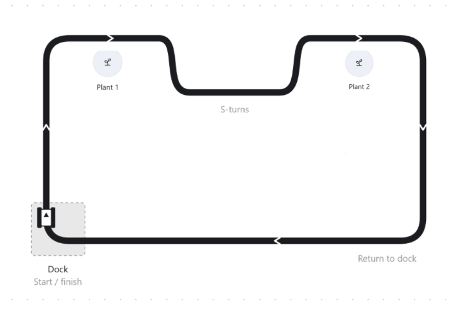

# Agreed Zumo track

Accepted by the user on **17 November 2026**. The car now uses a **Zumo base**;
the electronics are now specified as Arduino Uno + Zumo Shield with its
six-sensor reflectance array. Follow a **black line on white** using
[the supervised Zumo sketch](../Arduino_Uno/zumo_line_follow/README.md).

## Route

Follow the arrows clockwise for one circuit:

1. Leave the dock at the lower-left corner and head up the left side.
2. Pass **Plant 1** beside the upper-left section.
3. Follow the rounded **S-turns** across the top.
4. Pass **Plant 2** beside the upper-right section.
5. Follow the right side down, then the straight bottom section back to the dock.
6. Finish in the dock's start/finish zone.

Both pots sit beside the route. The layout is one continuous loop with no
crossings or branch junctions. Preserve the positions, bends and travel
direction in the supplied image.

## Dimensions and implementation

The image is the approved layout, not a dimensioned construction drawing.
Overall size, line/road width, bend radii, pot clearance and the dock stop marker
remain to be set for the actual Zumo and available floor space.

The existing Uno/L298N white-road driving code belongs to the earlier base;
it is superseded by the Zumo sketch. Physical track following and automatic dock
recognition/stopping have not been verified for this layout.

`track-layout.png` preserves the user's supplied image without modification.

## Higher-resolution image

[track-layout-high-res.png](track-layout-high-res.png) is the sharper
**1517 x 1037 pixel** version made with built-in Imagegen at the user's request.
The original reference is **892 x 610 pixels** and remains preserved above.
The route, labels, plant positions and arrow directions were visually checked.
The [edit prompt](track-layout-high-res-prompt.txt) records the request and
actual output size.
