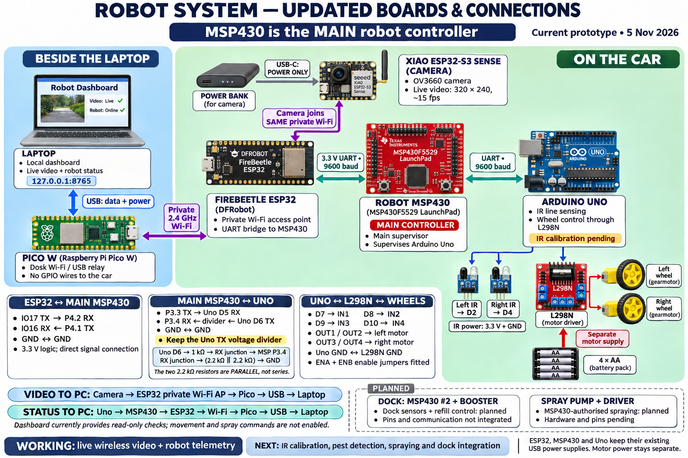
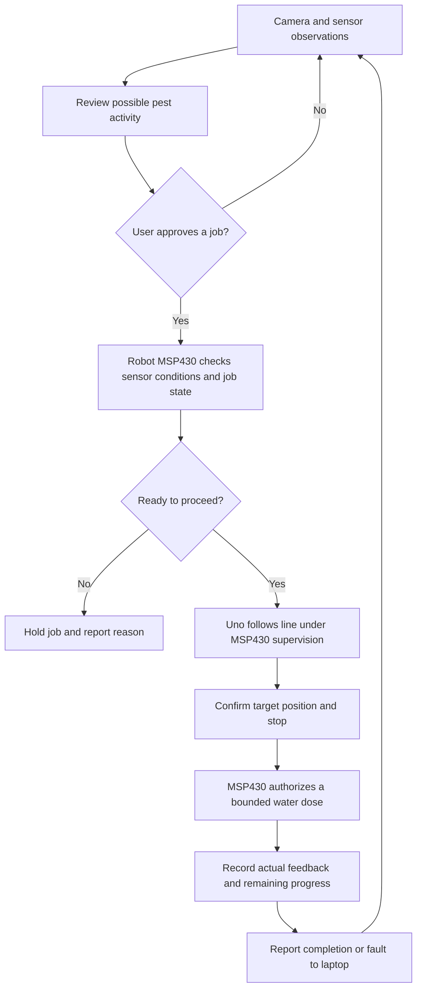
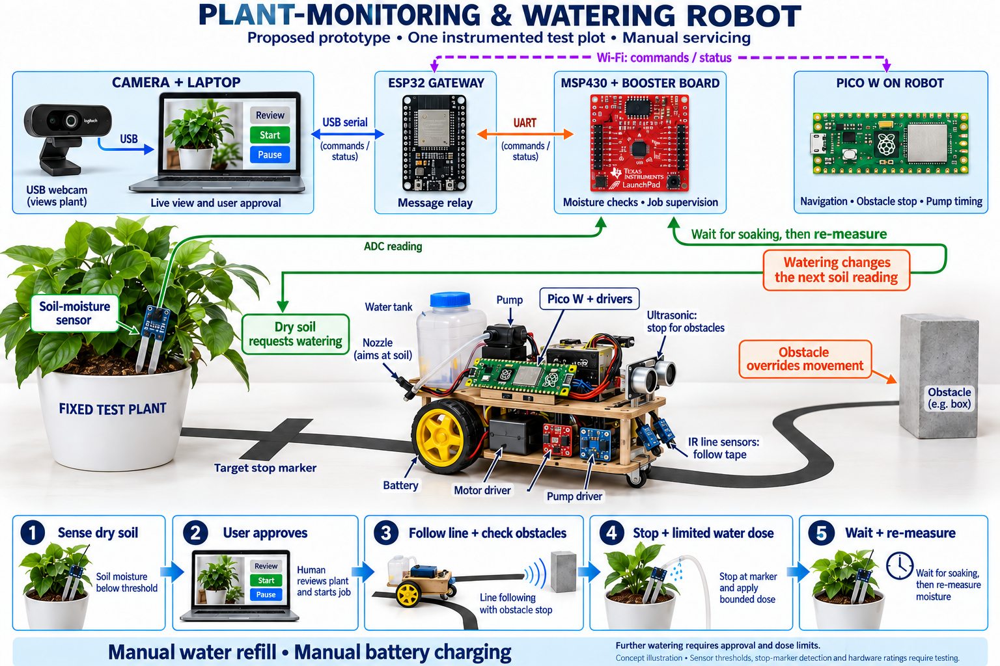
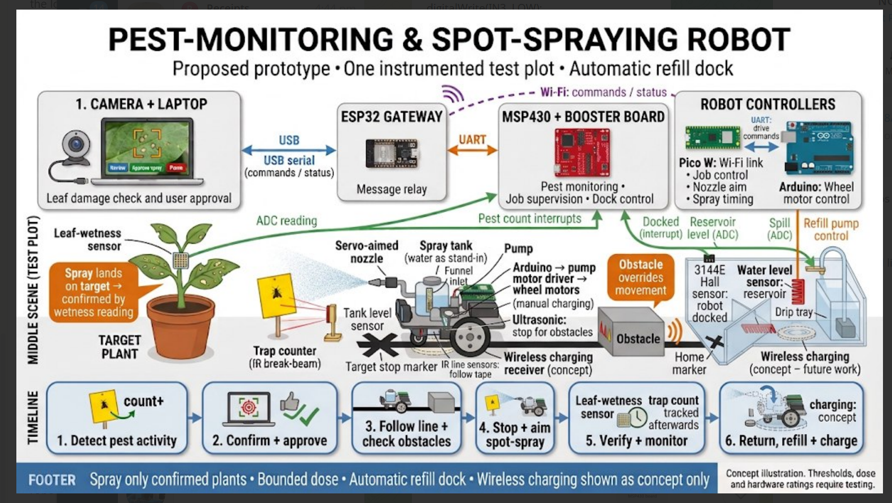

# Project diagrams

Start with the current placement diagram. Older images are included as design
history and can show features or board roles that have since changed.

## Current board placement — 5 November 2026



[Full-size PNG](../../Artifacts/diagrams/robot-system-connections-2026-11-05.png) ·
[Exact pins, roles and mounting notes](../../Tools/Communication/board-placement.md) ·
[Image source prompt](../../Artifacts/diagrams/robot-system-connections-2026-11-05.prompt.txt)

The Pico is beside the laptop; FireBeetle ESP32, main MSP430, Uno and XIAO
camera are on the car. MSP430 remains the main robot controller.

```text
Laptop ⇄ USB ⇄ Desk Pico ⇄ private Wi-Fi ⇄ Car ESP32 ⇄ UART ⇄ Main MSP430 ⇄ UART/divider ⇄ Uno
                                                 ⇅
                                            XIAO camera
```

Camera video returns through the ESP32 access point, Pico and laptop USB.
The camera uses power-bank USB-C for power only. Robot status returns from
Uno through MSP430, ESP32 and Pico. Both paths are working; the local dashboard
currently provides read-only checks. IR calibration, pest detection, spraying
and the second-MSP430 dock remain unfinished.

This is a signal/placement overview, not a physical pin-location guide or a
complete power schematic. The old Pico–MSP I2C bus is no longer used.

## Intended project workflow — not yet implemented end to end

[Proposed YOLO-on-laptop architecture](../../Artifacts/diagrams/yolo-laptop-architecture-2026-11-05.png)
shows the planned vision/control division and the car layout. It distinguishes
working video/status links from proposed target reports and stop/spray actions.
[Question for the professor](../../Artifacts/diagrams/yolo-laptop-professor-question-2026-11-05.txt)
and [image-generation prompt](../../Artifacts/diagrams/yolo-laptop-architecture-2026-11-05.prompt.txt).



Sensor thresholds, target confirmation, dose measurement and interlocks need
implementation and physical validation. An image alone is not proof of a pest
identity, and sending a pump command is not proof that liquid was delivered.

## Earlier concept illustrations

### Plant-monitoring and watering concept

This earlier plan used a fixed MSP430 and Pico motor control. The current design
puts the main MSP430 on the robot and gives wheel control to the Uno.



[Original generation prompt](../../Artifacts/diagrams/plant-care-robot-concept.prompt.txt)

### Pest-monitoring and spot-spraying concept

This supplied concept predates the two-MSP430 placement decision. Dock, spill
detection, aimed nozzle and charging details in the image are proposals, not
features demonstrated by Version 1.



### Earlier setup PDF

[Plant-care robot setup guide](../../Artifacts/pdf/plant-care-robot-setup-guide.pdf)
and its [source generator](../../Artifacts/setup/build_robot_setup.py) are retained
from the early concept stage. Use current sketch READMEs and wiring notes for
the latest assignments.

## Screenshot gallery

- [Dashboard with real MSP430 bench readings](../../Artifacts/verification/dashboard-live.png)
- [Mobile dashboard](../../Artifacts/verification/dashboard-mobile.png)
- [Initial dashboard](../../Artifacts/verification/dashboard-initial.png)
- [Mobile review screenshot](../../Artifacts/verification/dashboard-mobile-review.png)

All diagram/image files available in the project workspace are retained. Some
earlier chat diagrams existed only as temporary clipboard files that are no
longer on disk; they are not represented here as recovered originals. The live
Canva deck is also not bundled as an export in this release.
