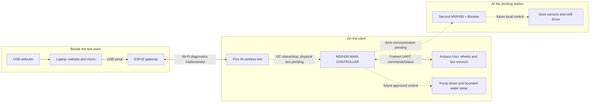

# ESP32 and Pico W wireless link

## Current design: desk Pico -> robot ESP32 -> MSP430

The Pico W is now USB-connected to the laptop and joins the robot FireBeetle's
private Wi-Fi. The ESP uses the new three-wire UART to the main MSP430; the Uno
retains the wheels/IR loop. Start with [desk-pico-setup.md](desk-pico-setup.md).
Both programs are uploaded and 20 full-path status requests passed on 5 November.
The desk stage is read-only; it does not forward motion, calibration or STOP.

## Archived Pico-on-robot arrangement

The BRIDGE2/Pico-I2C program and notes below are historical. They do not describe
the currently uploaded desk-Pico/robot-ESP programs. Do not use the old I2C
wiring/test instructions for the current route.

The robot **MSP430 remains the main controller**. These two boards carry messages;
they do not decide when to drive or spray. The current **BRIDGE2** firmware adds
MSP status and stop-request transport to the tested radio/LED diagnostics.
The MSP I2C endpoint is uploaded and USB-verified; the first wired test returned
NOT_CONNECTED. Follow the [Pico-to-MSP wiring guide](msp-bridge-wiring.md) to
resolve that connection. The [current design specification](board-placement.md)
maps every board, assigned pin and PC data path, including the planned onboard
XIAO camera and dock MSP. FireBeetle connects to PC by USB and to Pico by Wi-Fi.

| Device | Intended placement | Role |
| --- | --- | --- |
| Laptop (USB webcam in earlier bench setup) | Beside the test plant | Local website, images and user review |
| ESP32 FireBeetle DFR0478 | Beside laptop; USB attached | USB-to-Wi-Fi gateway |
| Pico W | On robot, near main MSP430 | Robot end of Wi-Fi; prepared I2C message bridge |
| Robot MSP430F5529 | On robot | Main sensor/job decisions and authorization |
| Arduino Uno | On robot | Wheel motors and two line sensors |
| Second MSP430 + Booster | At dock | Dock sensors and local refill control; firmware pending |

For programming today, **both ESP32 and Pico W connect directly to laptop USB**.
Their header pins remain disconnected. MSP430/Uno are not needed for this test.
The laptop stays on its existing internet connection: the ESP32 creates a separate
password-protected 2.4 GHz network which the Pico joins directly.

## Files

- ESP32: `../Laptop/Archive/ESP32_Laptop_Gateway/laptop_gateway/laptop_gateway.ino`
- Pico: `../Car/Archive/Pico_W/wireless_robot_link/main.cpp`
- Shared parser: `libraries/RobotBench/src/RobotBench.h`
- Local credentials: `local-network.json` and generated `NetworkConfig.h`, both ignored.
  Do not publish these or the compiled firmware, which embeds the password.
- Build both: run `./Laptop/Tools/Communication/build.ps1` from the project root.
  `-Target Pico` or `-Target ESP32` builds one board only; it never uploads.

The build helper uses the toolchains installed on this laptop: Pico SDK 2.3.1,
ARM GCC 15.2, CMake 4.3.4 and the Arduino ESP32 core. ESP32 target is
`esp32:esp32:firebeetle32` (original FireBeetle-ESP32, not FireBeetle 2).
The official variant uses a 4 MB flash layout, which fits inside this board's
detected 16 MB flash. No full-chip erase is needed.

`configure.py` generates one random network name/password shared by both builds.
Re-running it preserves the existing settings. It never reads home/lab Wi-Fi
credentials. If you intentionally change its JSON settings, rebuild/upload both.

## What to type

Open the ESP32 port in Arduino Serial Monitor at **115200 baud**, **New Line**.
Use uppercase commands. Only one serial application can own a port at a time.

| Command on ESP32 USB | Expected response/action |
| --- | --- |
| `PING` | `PONG ESP32_GATEWAY` |
| `STATUS` | `PICO_LINK=UP` when the wireless handshake succeeds |
| `ROBOT PING` | `ROBOT PONG PICO_W` — reply actually crossed Wi-Fi |
| `ROBOT STATUS` | Pico state, LED state and `MSP_LINK=NOT_CONNECTED` |
| `ROBOT LED ON` | Pico onboard green LED on |
| `ROBOT LED OFF` | Pico onboard green LED off |
| `ROBOT MSP STATUS` | MSP snapshot over I2C, or an explicit missing-peer error |
| `ROBOT MSP STOP` | Request MSP to stop; not physical-stop confirmation |
| `HELP` | List supported commands |

The Pico USB console supports `PING`, `STATUS`, `HELP` at 115200. Its local PING
reply is `PONG PICO_W_USB`. Its LED starts off and goes off on link loss; it is not
a power indicator in this firmware. Network discovery/reconnect may take seconds.
`BUSY` means a diagnostic request is still waiting for its reply: try again shortly.

`MSP_LINK=NOT_CONNECTED` means no valid MSP reply was obtained. The MSP endpoint
is uploaded and the user reports wiring complete, but the physical test failed.
BRIDGE2 transports only MSP status and stop requests. It does not start motors,
spray, recognize pests, refill or charge. The Version 1 website still needs a
gateway backend and an updated supervisor telemetry parser.

## Upload and test

1. Build both. Use the same generated credentials for both builds.
2. ESP32: use `./Laptop/Tools/Communication/upload_esp32.ps1 -Port COM15` from the project root
   after checking its current port. This uses the ROM loader at 115200 with small,
   uncompressed blocks. The standard compressed upload failed partway through
   even at 115200 on this connection; ROM upload completed and verified its hash.
   A fast 921600 backup read also failed; the 460800 backup retry succeeded.
   The precise cable/driver cause has not been isolated. Do not erase the full chip.
3. Pico: use `./Laptop/Tools/Communication/upload_pico.ps1 -Port COM11`, or enter BOOTSEL mode
   (hold BOOTSEL while connecting USB), then copy
   `../Car/Archive/Pico_W/wireless_robot_link/build/wireless_robot_link.uf2` to **RPI-RP2**.
   It reboots automatically. An SDK USB 1200-baud reset can also enter BOOTSEL.
4. Wait for `PICO_LINK=UP` on ESP32, then try `ROBOT PING` and the LED commands.
5. `tests/verify_hardware.py --esp COM15 --pico COM11 --reset-test` verifies the
   real USB/radio round trip, rejection of invalid commands and reset recovery.
   Check current ports first; these values can change. Add `--bridge-unwired`
   when checking BRIDGE2 with MSP I2C wires disconnected. Reports now use unique
   timestamps, preserving earlier evidence. The test controls onboard LEDs only.

The original motor, Pico LED test and MSP programs are retained in their existing
folders. A successful private backup of the ESP32's first 4 MiB is stored under
`../Car/Archive/ESP32/board_backup_2026-10-29/`; it is
not a complete 16 MiB flash image. Do not inspect/share it for this task.

## Protocol and next integration

TCP port 4242. Pico sends `HELLO PICO_W BRIDGE2`; gateway replies `WELCOME BRIDGE2`.
Both radio boards must use the same version.
Each request is `REQ <positive-id> <command>`; response `ACK <same-id> <payload>`.
IDs increase within a TCP connection. Only one request may be in flight. There is
no offline command queue, and no command is replayed on reconnection. Duplicate,
malformed or unexpected messages close the link. One-second heartbeat; two-second
reply timeout at gateway; five-second receive timeout at Pico. After 15 seconds
without a working session while Wi-Fi still reports UP, the Pico renews its
association and DHCP. This fixes the stale association seen after an ESP32 reset.
The Pico radio's power saving is disabled for this USB-powered bench firmware;
the earlier default caused intermittent reply timeouts. Battery runtime is not
measured. TCP checksums and
WPA2 protect transport in this bench setup; this is not an actuator authorization
or end-to-end safety protocol.

**Do not connect a Pico UART to MSP430 P3.3/P3.4.** Those UART0 pins serve the
working Uno link with the user-confirmed resistor divider on Uno TX. UART1
P4.4/P4.5 remains the USB console. The prepared Pico connection instead uses
I2C GP4/GP5 -> P3.0/P3.1, common GND and two 3.3V pull-ups. Its physical fault
remains unresolved. The dock communication path is still to be selected.

Next firmware milestone: integrate the robot MSP's command/status interface, then
job IDs, expiry, acknowledgements and local stop behaviour before enabling motion
or bounded water spraying. Physical sensor/driver tests remain separate.

## Earlier USB-webcam placement concept

This earlier diagram shows the USB-webcam bench arrangement. Use the
[current design specification](board-placement.md) for the added onboard XIAO
camera role and latest verification status. Solid arrows below show interface
assignments; dashed arrows show unresolved or future integration.

## Primary references

- [DFRobot DFR0478 original FireBeetle ESP32](https://wiki.dfrobot.com/dfr0478/)
- [Espressif Arduino Wi-Fi API](https://docs.espressif.com/projects/arduino-esp32/en/latest/api/wifi.html)
- [Official ESP32 core installation](https://docs.espressif.com/projects/arduino-esp32/en/latest/installing.html)
- [Raspberry Pi Pico SDK networking](https://www.raspberrypi.com/documentation/pico-sdk/networking.html)

The placement diagram is in [board-placement.md](board-placement.md).
Build and hardware verification results are recorded in `../../Laptop/Artifacts/verification/`
relative to either firmware folder. See [Version 1 notes](../../../CHANGELOG.md) for
the published milestone and remaining integration work.
