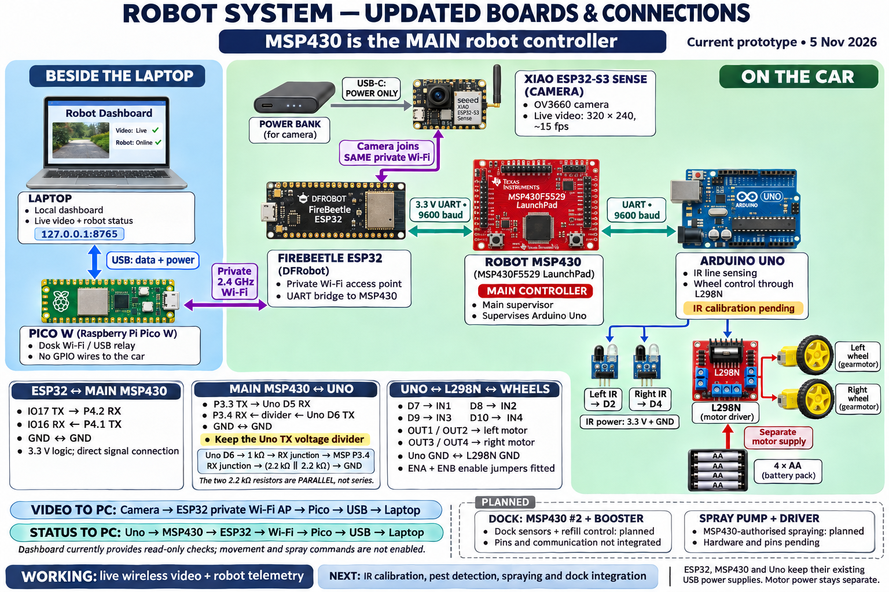

# Board roles, connections and PC data path

Updated 20 November 2026 for `V2_Working`. Driving uses the Zumo Shield and Uno. The
[Zumo guide](../../../Car/Arduino_Uno/zumo_line_follow/README.md) is the source
of truth for firmware, sensor wiring and operation. The 5 November image below
shows the previous L298N base; use the current connection tables instead.



[Full-size PNG](../../Artifacts/diagrams/robot-system-connections-2026-11-05.png) ·
[Image source prompt](../../Artifacts/diagrams/robot-system-connections-2026-11-05.prompt.txt)

The board drawings identify devices, not physical pin locations. Use the printed
pin labels and the exact signal tables below when wiring.

## Board placement and responsibilities

| Device | Placement | Current responsibility |
| --- | --- | --- |
| Laptop | Desk | Runs the local dashboard at http://127.0.0.1:8765, displays live video and robot status. |
| Raspberry Pi Pico W | Beside laptop | USB-to-Wi-Fi relay for video and status; no GPIO wires to the car. |
| Original FireBeetle ESP32, DFR0478 | Car | Creates the private 2.4 GHz Wi-Fi network and bridges robot status over UART. |
| MSP430 #1, MSP-EXP430F5529LP | Car | Grants motion, monitors sonar and water, and controls the three-second spray cycle. |
| Arduino Uno R3 + Zumo Shield | Car | OG6 reads the six line sensors, drives the tracks, acknowledges stops and sounds the optional flip alarm. |
| XIAO ESP32-S3 Sense camera | Car | Sends continuous OV3660 camera video wirelessly through the existing ESP32 network. USB-C supplies power from a power bank. |
| MSP430 #2 + Booster Board | Dock | P2.4 senses the magnet, P3.2 monitors the station reservoir and P1.4 controls the refill pump. [Dock project](../../../Docking_Station/README.md) |
| Water pump and 2N7000 | Car | A separate four-AA pack powers the pump. MSP430 P1.6 drives the MOSFET gate. |

## Communication and return paths

```text
Laptop <== USB data + power ==> Desk Pico W
                                  |
                           Private 2.4 GHz Wi-Fi
                                  |
                        FireBeetle ESP32 on car
                          |                 |
                 UART 9600 baud       Same Wi-Fi network
                          |                 |
                   Main robot MSP430   XIAO camera
                          |             (USB-C power only)
                 UART 9600 + divider
                          |
                     Arduino Uno
                          |
                 Zumo Shield + tracks
```

- **Video:** camera → ESP32 private Wi-Fi access point → Pico → USB → laptop.
- **Robot status:** Uno → MSP430 → ESP32 → Wi-Fi → Pico → USB → laptop.
- The camera stream does not pass through the MSP430. The MSP430 remains the
  main authority for robot actions.
- The laptop can keep its usual internet connection; the Pico joins the private
  network. The laptop does not need USB data connections to the car boards.
- Enabling blue-target detection lets the dashboard request a spray job and
  send the matching continuation. Calibration and the initial start use the Zumo button.

See the [local dashboard guide](../../Dashboard/README.md) and
[desk Pico setup](desk-pico-setup.md) for software and streaming details.

## Exact signal connections

### FireBeetle ESP32 to main robot MSP430 — UART, 9600 baud

| From | To |
| --- | --- |
| ESP32 IO17 / LRCK, TX | MSP430 P4.2, RX |
| MSP430 P4.1, TX | ESP32 IO16 / DI, RX |
| ESP32 GND | MSP430 GND |

Both ends use 3.3 V logic: direct signals, no divider or I2C pull-ups on this
link. Do not join the positive supply outputs. The installed MSP ESP-UART build
remaps UART1 to P4.1/P4.2; its old USB Application UART is no longer the supervisor
console. See the [ESP/MSP wiring guide](direct-wifi-wiring.md).

The former Pico GP4/GP5 to MSP P3.0/P3.1 I2C connection is obsolete. Pico needs
only its laptop USB connection in the current design.

### Main robot MSP430 to Uno — UART, 9600 baud

| From | To | Purpose |
| --- | --- | --- |
| MSP430 P3.3, TX | Uno D6, RX | Supervisor commands |
| Uno D13, TX | Divider, then MSP430 P3.4, RX | Acknowledgements and status |
| MSP430 GND | Uno GND | Shared reference |

User-specified current Uno TX divider:

```text
Uno D13 ── 2.2 kΩ ── RX junction ── MSP430 P3.4
                            └── 2.2 kΩ ── GND
```

The two 2.2 kΩ resistors are in series between TX and GND, with MSP RX at
their junction. Nominal output is 2.5V for a 5V input. Do not wire the Uno's
5V TX directly to the MSP430. D13 is reserved for UART, including its shield LED.

### Zumo array, motors and MSP sensors

| From | To |
| --- | --- |
| Zumo six-sensor array and motor driver | Shield's built-in Uno connections |
| MSP P3.2 | HC-SR04 TRIG |
| HC-SR04 ECHO | 2.2kΩ -> MSP P2.7 junction -> 3.3kΩ -> GND |
| HC-SR04 VCC / GND | 5V / common GND |
| Water sensor S | MSP P6.0 / ADC A0 |
| Water sensor V/+ and G/- | MSP 3.3V / common GND |
| MSP P1.6 | 2N7000 gate, with a pull-down from gate to source |

No external L298N or two separate IR sensors are used. The supplied Zumo code
follows black on white; MSP stopping also covers its powered calibration sweep.
The dashboard displays the P6.0 reading and estimates tank level after empty/full
calibration. [Pump circuit and flyback diode](../../../Car/MSP430/robot_supervisor/PUMP_SETUP.md#supplied-wiring)

## Power and mounting

- Pico: laptop USB data and power.
- Camera: power-bank USB-C power only; video travels over Wi-Fi.
- FireBeetle, MSP430 and Uno: keep their existing USB power supplies. A complete
  shared mobile power distribution/load test has not been established.
- Zumo motors: use the Zumo's supported battery/driver arrangement.
- Motor/pump current goes through suitable drivers and supplies, not GPIO.

Switch off interconnected board power before changing wires. Keep the motor
battery disconnected for communication-only work. Use spacers, keep boards dry,
keep antennas clear of metal/batteries, mount IR sensors downward at matching
height, and keep secured tubing away from electronics.

## Verified progress and remaining work

The desk Pico → ESP32 → MSP430 → Uno status path was verified on 5 November.
The camera also streamed from power-bank power through the same private network:
200 frames at 14.91 fps, no corrupted frames, and fresh MSP status at completion.
See [camera evidence](../../Artifacts/verification/camera-live-stream-2026-11-05-211019.json)
and [power-bank evidence](../../Artifacts/verification/camera-powerbank-wireless.json).
These checks do not establish complete physical driving or autonomous spraying.

The 20 November release includes target-triggered spraying, water telemetry and
obstacle pause/resume. The operator reported that replacing a resistor restored
pump operation. The [dock firmware](../../../Docking_Station/README.md) now
handles local magnetic arrival and timed refill. The laptop relays magnetic arrival and refill completion between
the station USB port and the existing desk Pico wireless link.

## Historical illustration

[4 November diagram](../../Artifacts/diagrams/robot-system-connections-2026-11-04.png)
and [its notes](../../Artifacts/diagrams/robot-system-connections-2026-11-04-notes.md)
show the superseded ESP-at-desk / Pico-on-car arrangement. Do not use that image
for current wiring.
