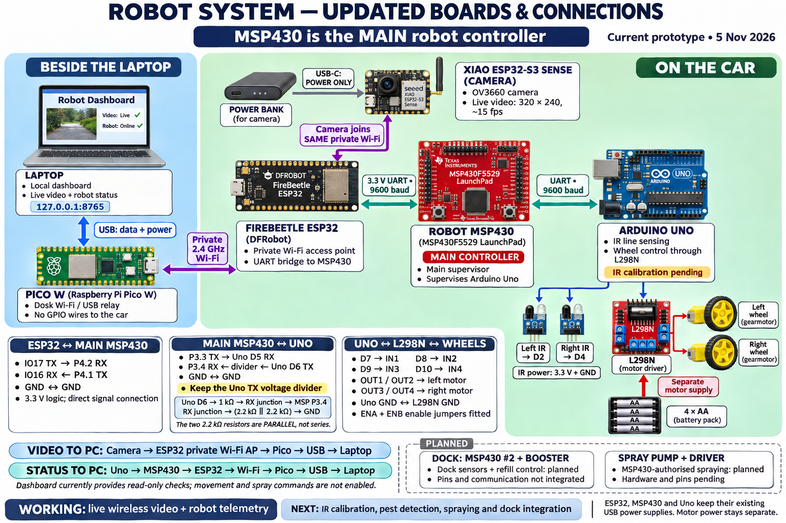

# Board roles, connections and PC data path

Updated 5 November 2026. This replaces the earlier Pico-on-car / MSP I2C layout.



[Full-size PNG](../../Artifacts/diagrams/robot-system-connections-2026-11-05.png) ·
[Image source prompt](../../Artifacts/diagrams/robot-system-connections-2026-11-05.prompt.txt)

The board drawings identify devices, not physical pin locations. Use the printed
pin labels and the exact signal tables below when wiring.

## Board placement and responsibilities

| Device | Placement | Current responsibility |
| --- | --- | --- |
| Laptop | Desk | Runs the local dashboard at http://127.0.0.1:8765, displays live video and robot status. |
| Raspberry Pi Pico W | Beside laptop | USB-to-Wi-Fi relay for video and status; no GPIO wires to the car. |
| Original FireBeetle ESP32, DFR0478 | Car | Creates the private 2.4 GHz Wi-Fi network and bridges robot status over UART. |
| MSP430 #1, MSP-EXP430F5529LP | Car | **Main robot controller**; supervises Uno, authorisation and communication timeouts. Job/spray logic remains pending. |
| Arduino Uno R3 | Car | Reads the two IR sensors and controls the L298N under MSP430 supervision. Physical calibration and track following remain deferred. |
| XIAO ESP32-S3 Sense camera | Car | Sends continuous OV3660 camera video wirelessly through the existing ESP32 network. USB-C supplies power from a power bank. |
| MSP430 #2 + Booster Board | Dock, planned | Local dock sensors and refill control. Pins, communication and firmware are not integrated. |
| Spray pump and suitable driver | Car, planned | Future bounded spraying authorised by the main MSP430; hardware/pins pending. |

## Communication and return paths

```text
Laptop <== USB data + power ==> Desk Pico W
                                  |
                           Private 2.4 GHz Wi-Fi
                                  |
                        FireBeetle ESP32 on car
                          |                 |
                 UART 9600 baud       Same Wi-Fi network
                          |                 |
                   Main robot MSP430   XIAO camera
                          |             (USB-C power only)
                 UART 9600 + divider
                          |
                     Arduino Uno
                          |
                    L298N + wheels
```

- **Video:** camera → ESP32 private Wi-Fi access point → Pico → USB → laptop.
- **Robot status:** Uno → MSP430 → ESP32 → Wi-Fi → Pico → USB → laptop.
- The camera stream does not pass through the MSP430. The MSP430 remains the
  main authority for robot actions.
- The laptop can keep its usual internet connection; the Pico joins the private
  network. The laptop does not need USB data connections to the car boards.
- The current dashboard performs read-only checks. Movement, calibration and
  spray commands are not enabled through the app.

See the [local dashboard guide](../../Dashboard/README.md) and
[desk Pico setup](desk-pico-setup.md) for software and streaming details.

## Exact signal connections

### FireBeetle ESP32 to main robot MSP430 — UART, 9600 baud

| From | To |
| --- | --- |
| ESP32 IO17 / LRCK, TX | MSP430 P4.2, RX |
| MSP430 P4.1, TX | ESP32 IO16 / DI, RX |
| ESP32 GND | MSP430 GND |

Both ends use 3.3 V logic: direct signals, no divider or I2C pull-ups on this
link. Do not join the positive supply outputs. The installed MSP ESP-UART build
remaps UART1 to P4.1/P4.2; its old USB Application UART is no longer the supervisor
console. See the [ESP/MSP wiring guide](direct-wifi-wiring.md).

The former Pico GP4/GP5 to MSP P3.0/P3.1 I2C connection is obsolete. Pico needs
only its laptop USB connection in the current design.

### Main robot MSP430 to Uno — UART, 9600 baud

| From | To | Purpose |
| --- | --- | --- |
| MSP430 P3.3, TX | Uno D5, RX | Supervisor commands |
| Uno D6, TX | Divider, then MSP430 P3.4, RX | Acknowledgements and status |
| MSP430 GND | Uno GND | Shared reference |

Keep the existing Uno TX divider:

```text
Uno D6 ── 1 kΩ ── RX junction ── MSP430 P3.4
                         ├── 2.2 kΩ ── GND
                         └── 2.2 kΩ ── GND
```

The two 2.2 kΩ resistors are **parallel**, not series. Nominal output is about
2.62 V for a 5 V input. Do not wire the Uno's 5 V TX directly to the MSP430.

### Uno, IR sensors and wheel motors

| From | To |
| --- | --- |
| Left IR OUT | Uno D2 |
| Right IR OUT | Uno D4 |
| Both IR VCC / GND | Uno 3.3 V / GND, matching the present setup |
| Uno D7 | L298N IN1 |
| Uno D8 | L298N IN2 |
| Uno D9 | L298N IN3 |
| Uno D10 | L298N IN4 |
| Uno GND | L298N GND |
| L298N OUT1 / OUT2 | Left motor |
| L298N OUT3 / OUT4 | Right motor |

ENA and ENB jumpers are fitted for on/off drive, with no PWM speed regulation
or wheel-encoder feedback. Left/right are viewed from behind, facing forward.
The current follower expects both sensors black when centred on a wide strip.
Sensor height, spacing, sensitivity and track calibration still need physical
validation. Reported controller state is not measured wheel motion.

## Power and mounting

- Pico: laptop USB data and power.
- Camera: power-bank USB-C power only; video travels over Wi-Fi.
- FireBeetle, MSP430 and Uno: keep their existing USB power supplies. A complete
  shared mobile power distribution/load test has not been established.
- L298N motors: separate four-AA supply, with common signal ground to Uno.
- Motor/pump current goes through suitable drivers and supplies, not GPIO.

Switch off interconnected board power before changing wires. Keep the motor
battery disconnected for communication-only work. Use spacers, keep boards dry,
keep antennas clear of metal/batteries, mount IR sensors downward at matching
height, and keep secured tubing away from electronics.

## Verified progress and remaining work

The desk Pico → ESP32 → MSP430 → Uno status path was verified on 5 November.
The camera also streamed from power-bank power through the same private network:
200 frames at 14.91 fps, no corrupted frames, and fresh MSP status at completion.
See [camera evidence](../../Artifacts/verification/camera-live-stream-2026-11-05-211019.json)
and [power-bank evidence](../../Artifacts/verification/camera-powerbank-wireless.json).
These checks do not establish complete physical driving or autonomous spraying.

Next: IR calibration/track tests, pest detection, sensor eligibility checks,
bounded spray control, and second-MSP dock integration. Ultrasonic, ADC tank/
soil/leaf sensing, nozzle and dock interfaces have no final pins here. Charging
remains manual; wireless charging and spill sensing are not added requirements.

## Historical illustration

[4 November diagram](../../Artifacts/diagrams/robot-system-connections-2026-11-04.png)
and [its notes](../../Artifacts/diagrams/robot-system-connections-2026-11-04-notes.md)
show the superseded ESP-at-desk / Pico-on-car arrangement. Do not use that image
for current wiring.
