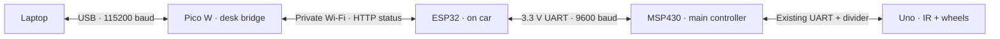

# Current wireless video update - 5 November 2026

The car camera now joins the existing FireBeetle private AP and streams to the
desk Pico at 192.168.4.10:4243. The Pico relays video plus robot status over laptop
USB. Use the [local dashboard](../../Dashboard/README.md) for video. Camera USB-C
is power only during operation; it can use the power bank. No GPIO wires needed.
DESK_BRIDGE_V2 keeps robot commands read-only. The dashboard internally uses
VIDEO ON/OFF to subscribe to the camera; do not enable binary video in a plain
text serial monitor. Close the dashboard before using the console below.

# Laptop Pico W -> private Wi-Fi ESP32 -> main MSP430

Current layout selected on 5 November 2026:

The Pico plugs into the laptop through USB. **It needs no GPIO jumper wires**
in this role. The FireBeetle ESP32 uses USB power from the power bank on the car.
Keep the MSP430 and Uno powered too. The motor supply stays disconnected for
communication tests. The laptop can keep using its ordinary Wi-Fi/internet;
the Pico's own radio joins the ESP32 private access point.

The main MSP430 keeps application authority. This stage reads identity and
status only. **The desk Pico cannot start motors, spray, calibrate or forward
STOP commands yet.** Existing local stop handling remains in the MSP/Uno.
Camera, ADC, pest detection, spraying and dock integration remain unfinished.

## Robot wires

| FireBeetle ESP32 | Robot MSP430 |
| --- | --- |
| IO17 / LRCK · TX | P4.2 · RX |
| IO16 / DI · RX | P4.1 · TX |
| GND | GND |

Both ends use 3.3 V UART logic; these three wires need no resistors. Preserve
the Uno's existing 5 V-to-MSP voltage divider. Change wires with all connected
boards unpowered. The Pico's old I2C pull-ups and P3.0/P3.1 wiring are not used.
See [the detailed ESP/MSP guide](direct-wifi-wiring.md) for header locations.

## Programs and builds

| Board | Program | Firmware identity |
| --- | --- | --- |
| Desk Pico W | `Laptop/Pico_W/laptop_wifi_bridge/main.cpp` | `DESK_BRIDGE_V2` |
| Robot FireBeetle ESP32 | `Car/ESP32_Gateway/robot_wifi_gateway/robot_wifi_gateway.ino` | `DIRECT_WIFI_V1` |
| Robot MSP430 | `Car/MSP430/robot_supervisor/main.c`, `-EspUart` build | `SUPERVISOR_V2`, `BRIDGE=ESP_UART_V1` |
| Uno | Existing `Car/Arduino_Uno/msp_line_follow` | Existing supervised controller |

Build the Pico with `Laptop/Tools/Communication/build_desk_pico.ps1`; upload using
`Laptop/Tools/Communication/upload_pico.ps1 -Port COM11 -Role Desk`. The uploader checks the
Pico USB identity, resets only that board and verifies the newly appearing
RP2040 BOOTSEL drive before copying the UF2. USB port numbers can change.

Build the robot ESP/MSP pair with `Laptop/Tools/Communication/build_direct.ps1`. Do not
upload the archived `Laptop/Archive/ESP32_Laptop_Gateway/laptop_gateway` or Pico `wireless_robot_link`
programs for this layout: their roles and network protocol differ.

All Wi-Fi programs use the same ignored `Laptop/Tools/Communication/local-network.json`
and generated `NetworkConfig.h`. Credentials are reused, not printed. Do not
commit those files or compiled Wi-Fi images. Original programs remain saved
for rollback; no old source has been deleted.

## Read status

Double-click **Open Pico Console.cmd** in this folder. It identifies the Pico,
opens only its USB port and presents a read-only console. Close this console
before running an automated test or opening another serial monitor.

| Type, then Enter | Meaning |
| --- | --- |
| `PING` | Identify the desk Pico firmware |
| `STATUS` | Current local Wi-Fi, ESP and MSP link freshness |
| `ROBOT PING` | Request a new ESP API identity response over Wi-Fi |
| `ROBOT MSP STATUS` | Read current ESP-confirmed main-MSP telemetry |
| `ROBOT STATE` | Full ESP JSON state, including telemetry age |
| `DIAG` | HTTP success/failure counts and last failure details |
| `Q` | Close the desktop console |

Expected normal local status includes `WIFI=UP ESP_LINK=UP MSP_LINK=UP`.
Robot telemetry should show `BOARD=MSP430F5529`, `BRIDGE=ESP_UART_V1`,
`LINK=READY RUN=0` for the stopped bench test. `CAL=NEEDED` and IR `NC` are
expected until the separate calibration work is done.

The Pico green LED stays **ON while this firmware is running**. It is not a
Wi-Fi link indicator. Use STATUS for connection state. The Pico validates the
ESP identity, complete HTTP body and MSP telemetry schema. Old responses become
stale; no cached status is presented as a fresh successful radio reply.

Reads normally complete quickly, but a dropped packet can delay a request.
The client allows up to8 seconds per HTTP read so lwIP's initial3-second TCP
retry can run. Failed reads return an error and clear link freshness. All
network operations in this stage are GET requests; no actuator request is
queued or replayed. The full local/hosted website is not connected to this
new USB protocol yet; the console and test script are the current viewers.

## Verification

On5 November the new desk image was uploaded and the complete hardware test
passed20 checks, including20 full-path status reads. The ESP returned fresh
MSP telemetry; the Uno stayed linked/stopped. UART_ERRORS was already1 and
did not increase; RX_DROPS and BAD_FRAMES stayed0. The host parser passed531
assertions. Evidence: `Laptop/Artifacts/verification/desk-wifi-2026-11-05-190533.json`.

Host parser test: `python Laptop/Tools/Communication/tests/check_desk_pico.py`.
Hardware test: `python Laptop/Tools/Communication/tests/verify_desk_wifi.py --pico COM11`.
The hardware test reads identity/status through the complete path and verifies
the Uno is linked and stopped. It does not exercise physical wheel motion,
calibration, spraying, remote STOP or dock operations.
