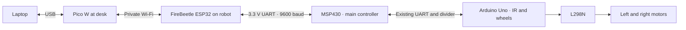
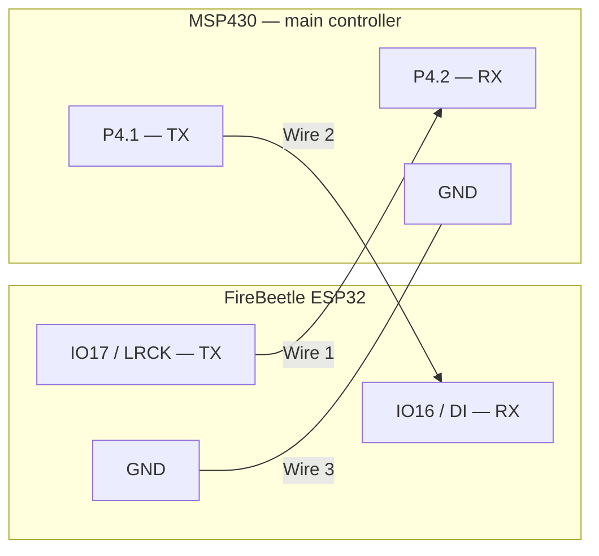

# Direct ESP32 Wi-Fi bridge to the robot MSP430

Current design, 5 November 2026: Pico W sits beside the laptop as its USB-to-Wi-Fi
bridge. The original FireBeetle ESP32 sits on the robot and creates the private
network that Pico joins. The ESP32 has a direct UART link to the robot MSP430,
which remains the main controller; the Uno retains wheel and IR control.
Start with [desk-pico-setup.md](desk-pico-setup.md) for laptop access.

The direct bridge currently supports **identity, status and stop requests**.
It cannot start movement, calibrate IR, spray or operate the dock. Existing Uno
line-following control and MSP authority remain in place. Pest detection, ADC
inputs, camera transport and the dock remain separate unfinished integrations.

## Three wires

Disconnect all interconnected board power and leave the motor battery off
before changing wires. Remove the old Pico SDA/SCL/3V3/GND connections from the
MSP/breadboard; the Pico can be unplugged. Preserve the Uno-to-MSP divider.

| FireBeetle ESP32 pin | Robot MSP430 side-header pin | Function |
| --- | --- | --- |
| **IO17 / LRCK** | **P4.2** | ESP TX -> MSP RX |
| **IO16 / DI** | **P4.1** | ESP RX <- MSP TX |
| **GND** | **GND** | Common signal ground |

This diagram groups the required pin labels; it is not a full physical pinout.
Both boards and all three short wires stay on the car. The laptop connects
to the ESP32 over private Wi-Fi; board power comes through their USB sockets.

Use GPIO numbers **16/17**, not the USB serial pins IO1/IO3. This is the original
DFR0478 FireBeetle, not FireBeetle 2. Both ends use 3.3 V logic, so these three
wires do not need a divider or 4.7 kOhm pull-ups. Keep the boards powered through
their own USB sockets. Do not connect their positive supply pins together.

With the LaunchPad USB socket at the top, **P4.2 and P4.1 are the bottom two
labelled pins in the outer column of the left side header**. Read the printed
pin labels before plugging in. P3.3/P3.4 remain assigned to the Uno.

The MSP firmware explicitly remaps UART1 to P4.1 TX / P4.2 RX. This mapping
requires the new **ESP UART build**; the old program does not use these pins
for UART. The original P4.4/P4.5 USB backchannel is disabled by this mapping.
The middle RXD/TXD jumper caps can stay fitted. MSP USB still provides power
and CCS/Spy-Bi-Wire programming, but its Application UART is no longer the
supervisor console. Use the ESP32 USB console instead.

References: [TI port-mapping guide, chapter 13](https://www.ti.com/lit/ug/slau208q/slau208q.pdf),
[LaunchPad header diagram](https://www.ti.com/lit/ug/slau533d/slau533d.pdf),
[DFRobot FireBeetle pinout](https://dfimg.dfrobot.com/wiki/19339/DFR0478_firebeetle-esp32-board_datasheet_v1.0.pdf).

## Programs

| Board | Program |
| --- | --- |
| ESP32 | `Car/ESP32_Gateway/robot_wifi_gateway/robot_wifi_gateway.ino` |
| Robot MSP430 | `Car/MSP430/robot_supervisor/main.c`, built with `SUPERVISOR_ESP_UART` |
| Uno | Existing `Car/Arduino_Uno/msp_line_follow/msp_line_follow.ino` |
| Desk Pico W | `Laptop/Pico_W/laptop_wifi_bridge/main.cpp` |

Run `Laptop/Tools/Communication/build_direct.ps1` to build both new programs. The MSP output
is `Car/MSP430/robot_supervisor/Debug_wifi/robot_supervisor.out`; the normal
`Debug/` output remains the older USB/I2C build for rollback. Network credentials
are reused from ignored `Laptop/Tools/Communication/local-network.json`; never commit that
file, generated `NetworkConfig.h`, or compiled Wi-Fi firmware.

## Laptop and power

The Pico uses laptop USB data/power. The ESP32 uses USB power from the robot's
power bank; the MSP430 and Uno also need their USB power. The motor supply is
separate. ESP USB is only needed again for its programming/debugging.

The private network name/password remain in `Laptop/Tools/Communication/local-network.json`.
Pico joins automatically and uses **http://192.168.4.1/api/state** internally.
The laptop keeps its ordinary Wi-Fi/internet and reads through Pico USB using
Open Pico Console.cmd. The older local/hosted dashboard still needs integration.

For ESP debugging, its USB console uses **115200 baud**, newline (the observed
Windows CH340 configuration error is separate from the working Wi-Fi link):

| Command | Result |
| --- | --- |
| `PING` | `PONG ESP32_DIRECT_WIFI_V1` |
| `STATUS` | AP, MSP link, firmware and pin assignments |
| `STATE` | Same JSON state as the HTTP API |
| `MSP PING` | Verify the new MSP UART firmware |
| `MSP STATUS` | Request correlated supervisor telemetry |
| `MSP STOP` | Send one stop request if the link is fresh and idle |

The ESP automatically polls identity/status. It reports `NOT_CONNECTED` until
the new UART connection passes. The HTTP API is `GET /api/state` and
`POST /api/stop`; the latter returns 202 for a dispatched request or 503 when
unavailable/busy. No offline command queue or automatic STOP replay exists.
`REQUEST_ACCEPTED` means the MSP accepted the request, not that wheel motion
was measured. Fresh MSP status must subsequently show `RUN=0`, `LINK=READY`
and the Uno FOLLOW flag clear before claiming the software stop handshake.

## Verification limits

On 5 November both new programs were uploaded. MSP flash verification passed;
debugger inspection confirmed the remapped P4.1/P4.2 UART and Uno linked/stopped
with zero error counters. ESP flash hashes passed and 12 USB firmware/AP checks
passed. Initial USB checks were performed before the new three-wire hookup.
The later desk-Pico Wi-Fi/HTTP test also passed20 full-path status reads; see
[the current desk guide](desk-pico-setup.md) and
`Laptop/Artifacts/verification/desk-wifi-2026-11-05-190533.json`. Initial evidence:
`Laptop/Artifacts/verification/direct-wifi-2026-11-05-165145.json` and
`Laptop/Artifacts/verification/msp-direct-uart-registers-2026-11-05.txt`.

Later that day, debugger inspection observed three successive ESP-originated
`NET <ID> STATUS` requests inside the MSP UART receive buffer, with advancing
IDs. The ESP only begins these polls after accepting a matching MSP identity
reply, providing evidence of the two-way UART handshake. The MSP reported Uno
linked and stopped throughout. The ESP USB console remained blocked by Windows
serial configuration errors; no HTTP response or remote STOP was tested.
See `Laptop/Artifacts/verification/direct-uart-observed-2026-11-05.json`.
Debugger pauses can disturb UART timing, and one malformed
Uno frame was recorded during this diagnostic.

Host tests exercise the actual MSP command gate, ID overflow/malformed inputs,
STOP restrictions and ESP reply matching. Builds check both target compilers.
Neither proves electrical UART operation. Firmware upload verification and the
physical three-wire test must be recorded separately. A finished bridge also
needs a laptop Wi-Fi HTTP test after the laptop joins its private network.

## Commands to verify the new route

Run `python Laptop/Tools/Communication/tests/verify_direct_wifi.py --esp COM15` after wiring. Add `--http` after the laptop joins the private network. The `--allow-unwired` mode verifies the new ESP USB/AP firmware and rejection of unsupported commands while clearly recording that physical MSP UART and laptop Wi-Fi HTTP are untested. It does not start motion or calibrate sensors.
