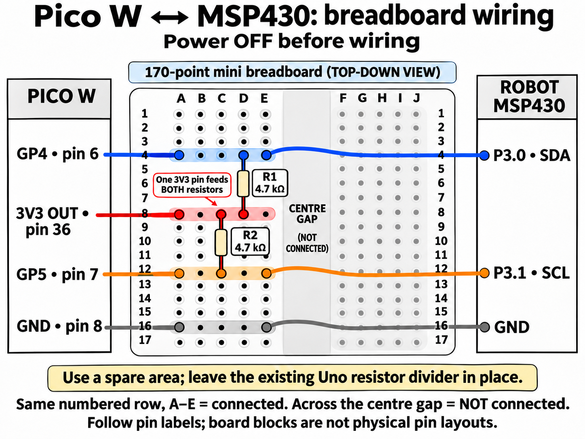

# Pico W to robot MSP430: status and stop-request bridge

This development stage keeps **MSP430 as the robot's main controller**. Pico W
carries messages, Arduino handles the wheels, and the desk ESP32 connects to
the laptop. IR calibration is not needed for communication tests.

The software is prepared for this wiring. **The first wired test on 3 November
did not pass: Pico returned `MSP ERROR NOT_CONNECTED`.** The user confirmed
both pull-ups and common ground were connected; the exact assembly still needs
inspection. MSP USB and ESP-to-Pico Wi-Fi replied correctly, and the MSP reported
its Uno link READY with RUN=0. Debugger inspection found the expected P3.0/P3.1
function selection and I2C address 0x32, but no valid request reached the MSP
mailbox during three probes. This does not establish the electrical root cause.
The updated `robot_supervisor` build was uploaded and USB-verified on 3 November.
The already uploaded Uno program is unchanged. Camera, spray and dock integration
remain separate work. The existing Version 1 website is not connected to this route yet.

## Wiring: next step



This example uses the **left half (A-E)** of a standard 170-point mini breadboard.
Each numbered A-E group is connected internally; the centre gap separates it
from F-J. Use empty rows/a spare board so the existing Uno divider stays intact.
The diagram's numbered rows are illustrative if your mini board is unlabelled.

| Hole | Insert |
| --- | --- |
| A4 | Pico GP4 (physical pin6) wire |
| E4 | MSP P3.0 wire |
| D4 and D8 | The two legs of resistor R1, 4.7 kOhm |
| A8 | Pico 3V3 OUT (physical pin36) wire |
| C8 and C12 | The two legs of resistor R2, 4.7 kOhm |
| A12 | Pico GP5 (physical pin7) wire |
| E12 | MSP P3.1 wire |
| A16 | Pico GND (physical pin8) wire |
| E16 | MSP GND wire |

R1's D8 leg, R2's C8 leg and the A8 power wire share **row8**. That is the
3.3V split; no extra Y-cable is needed. Resistors have no polarity. Only the
drawn insertion endpoints connect; outgoing wires pass over the unused right
half without plugging into it. Diagram resistor bodies omit colour bands;
use the actual 4.7 kOhm parts. [Simpler circuit view](../../Artifacts/diagrams/pico-msp430-i2c-simple.png).
Built-in image generation was used for these illustrations; [creation notes and final prompt](../../Artifacts/diagrams/pico-msp430-i2c-diagram-notes.md).

Turn the boards off before wiring. Keep motor battery disconnected for this test.
Use two **4.7 kOhm** resistors; two **2.2 kOhm** resistors also suit this short,
50 kHz, 3.3V bench bus. These are additional pull-ups, not the Uno RX divider.

| From Pico W | Connect to |
| --- | --- |
| GP4, physical pin 6 | MSP430 side-header **P3.0**, SDA/data |
| GP5, physical pin 7 | MSP430 side-header **P3.1**, SCL/clock |
| GND, physical pin 8 | MSP430 **GND** |
| 3V3 OUT, physical pin 36 | One end of each pull-up resistor |
| Other end of resistor 1 | SDA junction: GP4 / P3.0 |
| Other end of resistor 2 | SCL junction: GP5 / P3.1 |

```text
Pico 3V3 OUT (pin 36) ----+----------------+
                        |                |
                      4.7k             4.7k
                        |                |
Pico GP4 (pin 6) --------+----------------|---- MSP P3.0 (SDA)
Pico GP5 (pin 7) -------------------------+---- MSP P3.1 (SCL)
Pico GND (pin 8) ------------------------------ MSP GND
```

Keep both boards USB-powered while their signal wires are attached. **Do not
connect their 3V3 outputs together**, and do not connect this bus to 5V. It needs
no 5V level converter because both ends use 3.3V logic. Keep the wires short.
The Pico's weak internal pull-ups keep disconnected pins idle; use the external
resistors for the connected test.

Retain the existing Uno link on **MSP P3.3/P3.4** and its voltage divider/common
ground. Leave the middle **RXD and TXD jumper caps** fitted for MSP USB.
P3.0/P3.1 are different side-header pins; no Uno signal wire is moved.

Pin functions checked against the [TI MSP430F552x datasheet](https://www.ti.com/lit/ds/symlink/msp430f5529.pdf)
and [official Pico W pinout](https://datasheets.raspberrypi.com/picow/PicoW-A4-Pinout.pdf).
The [TI family guide, chapter 38](https://www.ti.com/lit/ug/slau208q/slau208q.pdf)
describes USCI_B I2C operation. Pico uses the [SDK's bounded I2C APIs](https://www.raspberrypi.com/documentation/pico-sdk/hardware.html#hardware_i2c).

## How to test

ESP32 stays on laptop USB. Open its serial console, **115200 baud, New Line**.
Only one application may open its serial port at a time.

| Command | Expected result |
| --- | --- |
| `PING` | `PONG ESP32_GATEWAY` |
| `ROBOT PING` | `ROBOT PONG PICO_W` across Wi-Fi |
| `ROBOT STATUS` | Pico identity, LED and last known MSP link state |
| `ROBOT MSP STATUS` | Fresh correlated reply from the MSP, or `MSP ERROR NOT_CONNECTED` |
| `ROBOT MSP STOP` | `MSP STOP=REQUESTED ...`, or `MSP ERROR STOP_OUTCOME_UNKNOWN` |

`STOP=REQUESTED` confirms the **MSP queued a stop**. It does not confirm a physical
wheel has stopped. Follow it with `ROBOT MSP STATUS`: check `LINK=READY`, `RUN=0`
and `(FLAGS & 8)==0` for an Uno-reported non-following state. Even that reports
controller state, not wheel motion; there are no wheel encoders in this test.
If the result is unknown, use the MSP's S2/local stop or disconnect motor power.

`FLAGS` comes from the Uno: 1 calibrated, 2 left black, 4 right black, 8 following,
16 fault, 32 left stable, 64 right stable, 128 sampling. When `LINK=SYNCING`, those
sensor flags can be old and must not be shown as current measurements.
`MSP_LINK=UP` means a valid recent reply; it becomes `STALE` after 1.5 seconds
without another successful MSP transaction. `ROBOT PING` checks Pico, not MSP.

Remote `MSP START`, `MSP F`, spray and calibration commands are intentionally
unavailable in this milestone. A Wi-Fi connection never starts movement. Local
MSP USB commands retain their existing behaviour. Wireless loss is not currently
an automatic stop trigger for movement started locally at the MSP; wireless
movement authorisation/lease handling has not been implemented.

## Implementation and validation limits

- ESP/Pico handshake is `BRIDGE2`; update both together. Old `BENCH1` peers fail
  the handshake, rather than partially interpreting new commands.
- I2C address is **0x32**, Pico initiates bus transfers at 50 kHz; MSP USCI_B0 is
  the addressed peripheral. Bus transfer direction does not change which board
  owns robot decisions.
- A 10-byte request contains version, STATUS/STOP opcode, nonzero 32-bit token
  and CRC16-CCITT-FALSE. A 24-byte response echoes opcode/token and reports a
  snapshot of the MSP/Uno state. No movement-start opcode exists on this bus.
- MSP ISR handles bounded buffers; its main loop validates the command, requests
  stop if applicable, then publishes a response. Reads use a consistent snapshot.
- Pico bounds each I2C call to 20 ms and each transaction to 600 ms, re-reading
  an old mailbox response until the matching reply arrives. It never resends
  an uncertain command. Reconnect clears the pending network request.
- CRC/token checks detect corruption/stale replies, not malicious access.
  Acknowledging STOP is not equivalent to a verified emergency-stop circuit.

Build: `Laptop/Tools/Communication/build.ps1`; MSP: `Car/MSP430/build_robot_supervisor.ps1`.
USB uploads: `Laptop/Tools/Communication/upload_pico.ps1 -Port COM11` and
`Laptop/Tools/Communication/upload_esp32.ps1 -Port COM15` after confirming current ports.
MSP requires a separate verified CCS/DSLite upload. Firmware files contain local
Wi-Fi credentials and are intentionally ignored by Git.

Software checks: `Laptop/Tools/Communication/tests/check_bridge.py` exercises the actual
codec, MSP dispatcher and Pico transaction class with stubbed I/O. The MCU builds
check compilation, not electrical behaviour. With both radio boards connected
and **MSP I2C wires absent**, `Laptop/Tools/Communication/tests/verify_hardware.py --esp COM15
--pico COM11 --reset-test --bridge-unwired` checks the real radio link and honest
missing-peer reporting.

For the current arrangement (ESP and MSP on laptop USB; Pico on external USB),
run `Laptop/Tools/Communication/tests/verify_wired_bridge.py --esp COM15 --msp COM13` after
checking the current ports. It verifies identities, fresh I2C status, stop-request
acknowledgement and independent stopped-state readback, repeated status and
freshness reporting. It never starts or calibrates the car. The first attempt
stopped at the missing I2C reply; **no remote STOP was sent**, and the later
checks remain untested. Evidence: `Laptop/Artifacts/verification/wired-bridge-2026-11-03-231731.json`
and `Laptop/Artifacts/verification/msp-i2c-registers-2026-11-03-2321.txt`. Motor motion and
reset recovery are outside this wired test's scope.
