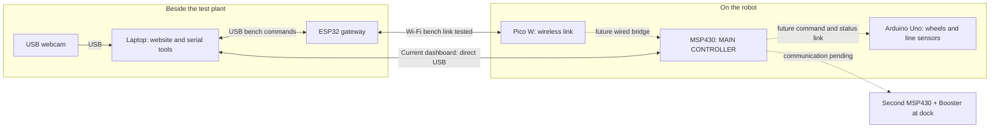
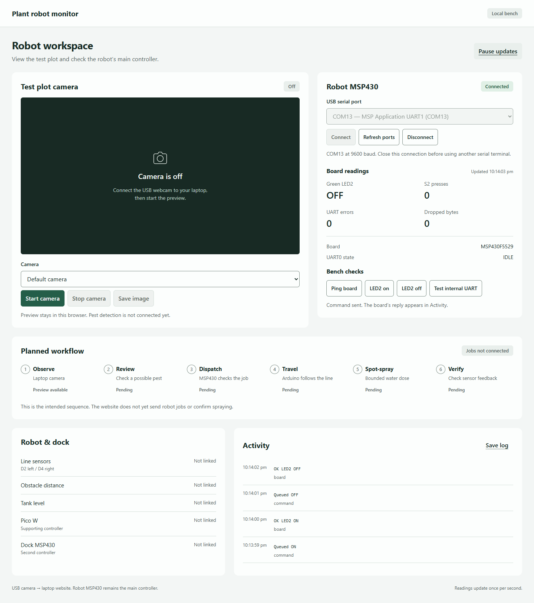

# Pest-Monitoring & Spot-Spraying Robot

**CEG2001 Sensor Control · CEG2002 Embedded System Design**

**Version 1 — `v1.0.0` · 29 October 2026**

A student prototype that combines plant observation, sensor feedback and a mobile
robot for targeted treatment. The intended demonstration uses **water** in place
of pesticide. The **MSP430 on the robot is the main embedded controller**; the
other boards provide communication, navigation and dock support.

Version 1 is a collection of working bench programs and a local dashboard.
**It is not yet a complete autonomous pest-detection or spraying system.**

[Start testing](#start-testing) · [Diagrams](docs/diagrams/README.md) ·
[Wiring](docs/wiring.md) · [Version 1 notes](CHANGELOG.md) ·
[Documents and test evidence](output/README.md)

## What works in Version 1

| Area | Included and checked | Remaining work |
| --- | --- | --- |
| Robot MSP430 | USB commands, LED controls, button handling, internal UART loopback; 19 USB checks passed | Robot job state machine and physical board-to-board links |
| ESP32 ↔ Pico W | Private Wi-Fi link, request/reply, Pico LED controls, timeout/reconnection; 19 checks passed, including 30 sustained round trips | MSP430 bridge and website integration |
| Arduino Uno | Separate motor, IR calibration, line-following and UART bench sketches; compiled control checks | Reliable track calibration, physical steering validation, MSP430 command integration |
| Local website | MSP430 bench telemetry, event log, LED/loopback controls, local camera preview | Pest detection, job approval/dispatch and sensor/spray telemetry |
| Dock | Placement and controller role documented | Second MSP430/Booster firmware, sensors and communication |

Earlier motor operation was reported by the project user. The later line-following
session exposed a loose motor-supply wire; its repair and full track test are still
pending. A serial message such as `MODE=FORWARD` confirms the requested output,
not that a wheel actually moved.

## Where each board goes

| Device | Placement | Responsibility |
| --- | --- | --- |
| USB webcam + laptop | Beside the test plant/trap | Images, local website and future detection/user review |
| ESP32 FireBeetle DFR0478 | Beside the laptop, connected by USB | Laptop end of the wireless link |
| Raspberry Pi Pico W (RP2040) | On the robot | Robot end of the wireless link |
| MSP430F5529 LaunchPad | On the robot | **Main controller:** future sensor/job decisions and authorization |
| Arduino Uno R3 | On the robot | Wheels through L298N; left/right IR line sensors |
| Second MSP430 + Booster | At the dock | Future local docking/refill control |



Solid links show current connection roles; dashed links are future integration.
The ESP32 console and MSP430 website are **separate tests** in this release.
The website does not yet communicate through the ESP32/Pico route.

## Start testing

Clone the repository:

```powershell
git clone https://github.com/Pskm12E/CEG2001-Sensor-Control-AND-CEG2002-Embedded-System-Design-Project.git
cd CEG2001-Sensor-Control-AND-CEG2002-Embedded-System-Design-Project
```

To reproduce this snapshot later, check out `v1.0.0`. Upload only the sketch for
the test you intend to run: each upload replaces that board's previous program.
COM numbers below are from the original laptop and can change on another machine.

### 1. Try the ESP32 and Pico wireless link

**Already programmed boards:** connect both to laptop USB using data cables.
The MSP430 and Uno are not needed. Leave external GPIO wiring disconnected for
this onboard-LED test. The ESP32 creates its own network; the laptop does not need
to switch away from its internet Wi-Fi.

Open the **ESP32** serial port (**COM15** on the original laptop), select
**115200 baud**, **New Line**, and send:

| Command | Expected result |
| --- | --- |
| `STATUS` | `PICO_LINK=UP` once connected |
| `ROBOT PING` | `ROBOT PONG PICO_W` |
| `ROBOT LED ON` | Pico onboard LED turns on |
| `ROBOT LED OFF` | Pico onboard LED turns off |
| `ROBOT STATUS` | Pico state and `MSP_LINK=NOT_CONNECTED BENCH_ONLY` |

The Pico USB port was **COM11**. Its own console accepts `PING`, `STATUS`, `HELP`.
`MSP_LINK=NOT_CONNECTED` is expected: the MSP bridge has not been implemented.

**Fresh build:** install Arduino CLI/IDE with Espressif core **3.3.12**, plus
Pico SDK **2.3.1** and its C/C++ toolchain. Generate a private network configuration
before building either board:

```powershell
python Wireless_Link/configure.py
```

Build/upload both boards with that same configuration. Neither the password nor
compiled firmware containing it is stored in Git. On the original Windows setup,
`./Wireless_Link/build.ps1` builds both. Its tool paths are machine-specific;
review them on a new computer. The ESP32 target is `esp32:esp32:firebeetle32`;
the Pico target is `pico_w`, not Pico 2.

See the [complete wireless build/upload guide](Wireless_Link/README.md).
For Arduino CLI builds, include `--libraries ./Wireless_Link/libraries`; the
`RobotBench` helper library is local to this repository.

### 2. Try the robot MSP430 and website

Use [MSP430_Code/robot_usb_console](MSP430_Code/robot_usb_console/README.md),
the current MSP430F5529 bench project. Import it into TI Code Composer Studio,
build for **MSP430F5529**, and upload if it is not already installed. The project
was verified with CCS **21.0.1** and TI MSP430 compiler **21.6.3.LTS**.

For a fresh Python setup, run from the repository root:

```powershell
py -3 -m venv Local_Website/.venv
./Local_Website/.venv/Scripts/python.exe -m pip install -r Local_Website/requirements.txt
./Local_Website/.venv/Scripts/python.exe Local_Website/server.py --open
```

Then:

1. Open **http://127.0.0.1:8765** and plug in the robot MSP430 by USB.
2. Select **MSP Application UART1** — previously **COM13** — and connect.
3. Try Ping or LED2 On/Off. Press S2 to check the button count.
4. Plug the USB webcam into the **laptop**, then start the camera preview.

The dashboard uses **9600 baud** and only accepts the MSP Application UART.
Do not select its debug interface (previously COM14). Close other serial tools
using the same port. The site runs locally; camera tests so far used synthetic
video, so actual image quality/pest visibility still needs checking.



[Website guide](Local_Website/README.md) ·
[MSP430 commands and future UART wiring](MSP430_Code/robot_usb_console/README.md)

### 3. Test Arduino navigation separately

Use Arduino IDE with **Arduino Uno** / AVR core **1.8.8**. Choose one sketch:

| Sketch | Purpose |
| --- | --- |
| [uno_forward_test](Arudino_Code/uno_forward_test/uno_forward_test.ino) | `f` drives continuously; `s` stops. No automatic timeout. |
| [ir_line_test](Arudino_Code/ir_line_test/README.md) | Read and calibrate two digital IR sensors; motor outputs held stopped. |
| [line_follow_car](Arudino_Code/line_follow_car/README.md) | Calibrate with `w`/`b`, start with `f`, stop with `s`. Both sensors see black when centred. |
| [uart_link_bench](Arudino_Code/uart_link_bench/README.md) | Future MSP-to-Uno LED/serial test; compiled, physical link not yet tested. |

All Uno USB tests use **115200 baud**. The navigation pin map is left IR **D2**,
right IR **D4**, and L298N IN1–IN4 on **D7–D10**. Keep motor power disconnected
while uploading; verify supply, enable jumpers and polarity before a wheel test.
Read the [wiring guide](docs/wiring.md) before connecting the boards together.

## Repository guide

```text
Arudino_Code/       Uno motor, IR, line-following and UART bench sketches
ESP32_Code/         Laptop wireless gateway
Pico_Codes/         Current wireless link plus earlier independent experiments
MSP430_Code/        Robot MSP430 projects, build helpers and tests
Wireless_Link/     Shared protocol, private-config generator, setup and placement
Local_Website/     Local Python server, browser UI and tests
docs/              Wiring, diagram gallery and Version 1 documentation
output/            Saved diagrams, historical PDF guide, screenshots and test reports
CHANGELOG.md       Version 1 scope and verification
```

`Arudino_Code` keeps the original folder spelling so existing project paths work.
The older Pico motor sketch is an experiment, **not** the current motor controller.
The current motor role belongs to the Uno.

## Diagrams and documents

- [Diagram gallery](docs/diagrams/README.md): current layout, planned workflow and older concepts.
- [Detailed board-placement diagram](Wireless_Link/board-placement.md).
- [Current wiring and unassigned links](docs/wiring.md).
- [Earlier plant-care setup PDF](output/pdf/plant-care-robot-setup-guide.pdf): historical, not the current wiring authority.
- [All saved artifacts and reports](output/README.md).

Older concept pictures contain superseded controller roles and unimplemented
charging/refill features. They are retained as design history; use the current
README and wiring guide to decide what is connected today.

## Verification and next milestone

Saved results are dated **29 October 2026** and describe the tested bench setup:

- [MSP430 USB report](output/verification/msp430-usb-console-2026-10-29.json): 19 checks passed.
- [Wireless report](output/verification/wireless-bench-2026-10-29.json): 19 checks passed, including 30 sustained requests and gateway-reset recovery.
- [Dashboard report](output/verification/local-dashboard-2026-10-29.json): software, live-board and browser checks; camera tests used synthetic video.
- Uno line-following helper assertions passed at compile time; they do not replace a physical track test.

Software-only dashboard tests:

```powershell
./Local_Website/.venv/Scripts/python.exe -m unittest discover -s Local_Website/tests -v
```

The next milestone is the **main MSP430 command/status bridge**, followed by
sensor validation, navigation feedback and a bounded water-spray job. The dock
controller and pest-recognition evaluation remain future work. No complete
battery/pump/charging wiring has been approved by these bench tests.

## Files kept local

Wi-Fi credentials, old lab-board backups, firmware binaries, temporary tools,
logs and private session notes are excluded from Git. Firmware binaries can
embed network passwords; build them locally. Dependencies are installed separately.
Existing third-party notices, including Raspberry Pi's SDK helper licence, are retained.
