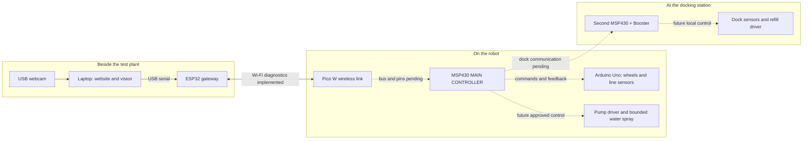

# ESP32 and Pico W wireless bench setup

The robot **MSP430 remains the main controller**. These two boards carry messages;
they do not decide when to drive or spray. This first firmware proves the wireless
connection using USB status messages and the Pico's onboard LED.

| Device | Intended placement | Role |
| --- | --- | --- |
| Laptop + USB webcam | Beside the test plant | Local website, images and user review |
| ESP32 FireBeetle DFR0478 | Beside laptop; USB attached | USB-to-Wi-Fi gateway |
| Pico W | On robot, near main MSP430 | Robot end of Wi-Fi link; future message bridge |
| Robot MSP430F5529 | On robot | Main sensor/job decisions and authorization |
| Arduino Uno | On robot | Wheel motors and two line sensors |
| Second MSP430 + Booster | At dock | Dock sensors and local refill control; firmware pending |

For programming today, **both ESP32 and Pico W connect directly to laptop USB**.
Their header pins remain disconnected. MSP430/Uno are not needed for this test.
The laptop stays on its existing internet connection: the ESP32 creates a separate
password-protected 2.4 GHz network which the Pico joins directly.

## Files

- ESP32: `../ESP32_Code/laptop_gateway/laptop_gateway.ino`
- Pico: `../Pico_Codes/wireless_robot_link/main.cpp`
- Shared parser: `libraries/RobotBench/src/RobotBench.h`
- Local credentials: `local-network.json` and generated `NetworkConfig.h`, both ignored.
  Do not publish these or the compiled firmware, which embeds the password.
- Build both: run `./Wireless_Link/build.ps1` from the project root.
  `-Target Pico` or `-Target ESP32` builds one board only; it never uploads.

The build helper uses the toolchains installed on this laptop: Pico SDK 2.3.1,
ARM GCC 15.2, CMake 4.3.4 and the Arduino ESP32 core. ESP32 target is
`esp32:esp32:firebeetle32` (original FireBeetle-ESP32, not FireBeetle 2).
The official variant uses a 4 MB flash layout, which fits inside this board's
detected 16 MB flash. No full-chip erase is needed.

`configure.py` generates one random network name/password shared by both builds.
Re-running it preserves the existing settings. It never reads home/lab Wi-Fi
credentials. If you intentionally change its JSON settings, rebuild/upload both.

## What to type

Open the ESP32 port in Arduino Serial Monitor at **115200 baud**, **New Line**.
Use uppercase commands. Only one serial application can own a port at a time.

| Command on ESP32 USB | Expected response/action |
| --- | --- |
| `PING` | `PONG ESP32_GATEWAY` |
| `STATUS` | `PICO_LINK=UP` when the wireless handshake succeeds |
| `ROBOT PING` | `ROBOT PONG PICO_W` — reply actually crossed Wi-Fi |
| `ROBOT STATUS` | Pico state, LED state and `MSP_LINK=NOT_CONNECTED` |
| `ROBOT LED ON` | Pico onboard green LED on |
| `ROBOT LED OFF` | Pico onboard green LED off |
| `HELP` | List supported commands |

The Pico USB console supports `PING`, `STATUS`, `HELP` at 115200. Its local PING
reply is `PONG PICO_W_USB`. Its LED starts off and goes off on link loss; it is not
a power indicator in this firmware. Network discovery/reconnect may take seconds.
`BUSY` means a diagnostic request is still waiting for its reply: try again shortly.

`MSP_LINK=NOT_CONNECTED` is expected today. These programs **do not yet** transport
MSP commands, connect to the local website, read plant sensors, recognize pests,
drive motors, spray, refill or charge. The existing website currently speaks directly
to the MSP430 USB console. Add a gateway backend only after the MSP link is defined.

## Upload and test

1. Build both. Use the same generated credentials for both builds.
2. ESP32: use `./Wireless_Link/upload_esp32.ps1 -Port COM15` from the project root
   after checking its current port. This uses the ROM loader at 115200 with small,
   uncompressed blocks. The standard compressed upload failed partway through
   even at 115200 on this connection; ROM upload completed and verified its hash.
   A fast 921600 backup read also failed; the 460800 backup retry succeeded.
   The precise cable/driver cause has not been isolated. Do not erase the full chip.
3. Pico: enter BOOTSEL mode (hold BOOTSEL while connecting USB), then copy
   `../Pico_Codes/wireless_robot_link/build/wireless_robot_link.uf2` to **RPI-RP2**.
   It reboots automatically. An SDK USB 1200-baud reset can also enter BOOTSEL.
4. Wait for `PICO_LINK=UP` on ESP32, then try `ROBOT PING` and the LED commands.
5. `tests/verify_hardware.py --esp COM15 --pico COM11 --reset-test` verifies the
   real USB/radio round trip, rejection of invalid commands and reset recovery.
   Check current ports first; these values can change. It only controls onboard LEDs.

The original motor, Pico LED test and MSP programs are retained in their existing
folders. A successful private backup of the ESP32's first 4 MiB is stored under
`../ESP32_Code/board_backup_2026-10-29/`; it is
not a complete 16 MiB flash image. Do not inspect/share it for this task.

## Protocol and next integration

TCP port 4242. Pico sends `HELLO PICO_W BENCH1`; gateway replies `WELCOME BENCH1`.
Each request is `REQ <positive-id> <command>`; response `ACK <same-id> <payload>`.
IDs increase within a TCP connection. Only one request may be in flight. There is
no offline command queue, and no command is replayed on reconnection. Duplicate,
malformed or unexpected messages close the link. One-second heartbeat; two-second
reply timeout at gateway; five-second receive timeout at Pico. After 15 seconds
without a working session while Wi-Fi still reports UP, the Pico renews its
association and DHCP. This fixes the stale association seen after an ESP32 reset.
The Pico radio's power saving is disabled for this USB-powered bench firmware;
the earlier default caused intermittent reply timeouts. Battery runtime is not
measured. TCP checksums and
WPA2 protect transport in this bench setup; this is not an actuator authorization
or end-to-end safety protocol.

**Do not connect a Pico UART to MSP430 P3.3/P3.4 yet.** Those MSP UART0 pins are
already proposed for the Uno through a 3.3 V/5 V converter. MSP UART1 P4.4/P4.5
is currently used by the USB dashboard. The Pico-to-MSP bus/pins must be selected
before wiring; options include a separate available peripheral or a deliberate
replacement of the USB backchannel once wireless monitoring is ready. No such
rewiring has been done. The dock communication path is also still to be selected.

Next firmware milestone: integrate the robot MSP's command/status interface, then
job IDs, expiry, acknowledgements and local stop behaviour before enabling motion
or bounded water spraying. Physical sensor/driver tests remain separate.

## Placement concept

Solid arrows below show this bench link. Dashed arrows are future integration.

## Primary references

- [DFRobot DFR0478 original FireBeetle ESP32](https://wiki.dfrobot.com/dfr0478/)
- [Espressif Arduino Wi-Fi API](https://docs.espressif.com/projects/arduino-esp32/en/latest/api/wifi.html)
- [Official ESP32 core installation](https://docs.espressif.com/projects/arduino-esp32/en/latest/installing.html)
- [Raspberry Pi Pico SDK networking](https://www.raspberrypi.com/documentation/pico-sdk/networking.html)

The placement diagram is in [board-placement.md](board-placement.md).
Build and hardware verification results are recorded in `../../output/verification/`
relative to either firmware folder. See [Version 1 notes](../CHANGELOG.md) for
the published milestone and remaining integration work.
