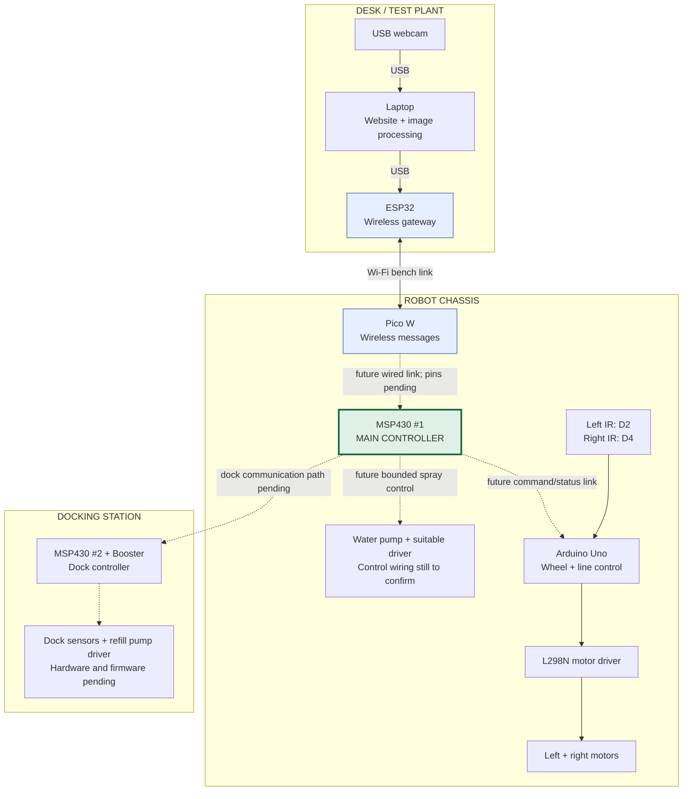

# Board placement

**During today's setup:** plug the ESP32 and Pico W into the laptop by USB.
The MSP430 can stay unplugged. No jumper wires between boards are needed for
the wireless LED test.

**On the finished prototype:** the ESP32 stays beside the laptop, the Pico W
rides on the robot, and the robot's MSP430 remains in charge.

Solid arrows describe physical connections or the wireless bench link. They do
not certify the entire robot has been tested. Dashed arrows are future integration.
The website-to-gateway connection still needs software integration; today's ESP32
USB commands use a serial console.

Mount the robot's electronics on a dry upper platform with spacers. Keep the
Pico's antenna end clear of the battery, motor driver and metal. Mount the two IR
sensors at the front facing down at matching height; mounting height/spacing and
the wide black strip must be calibrated together. Place the water tank low and
securely, with the pump and tubing separated from the boards. Final power
distribution and pump ratings must be checked before connecting them.

Charging remains manual. This diagram does not add wireless charging or a leak
sensor. The dock's exact sensing, Booster model and robot communication path are
still to be confirmed.
