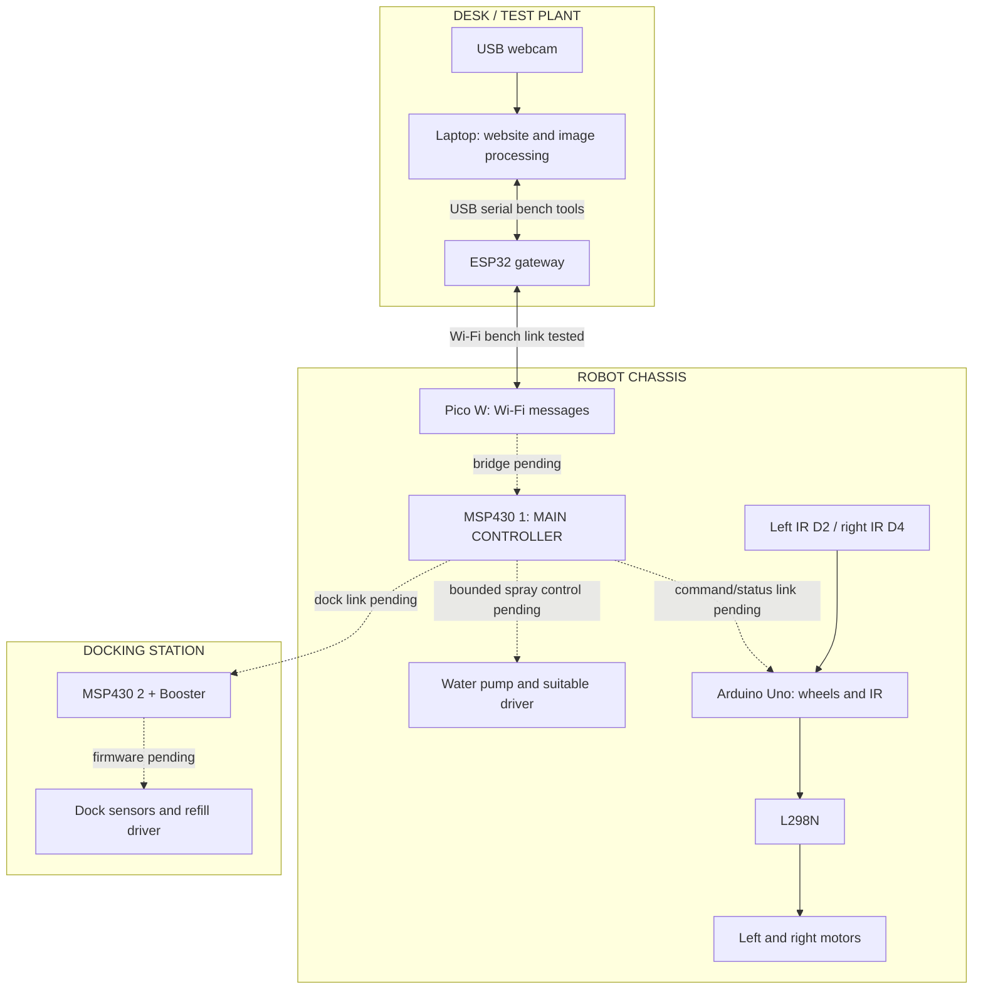
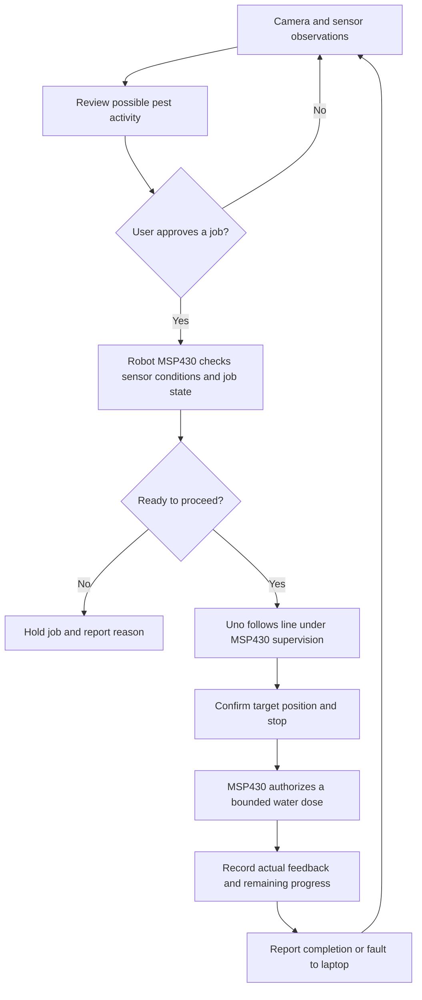
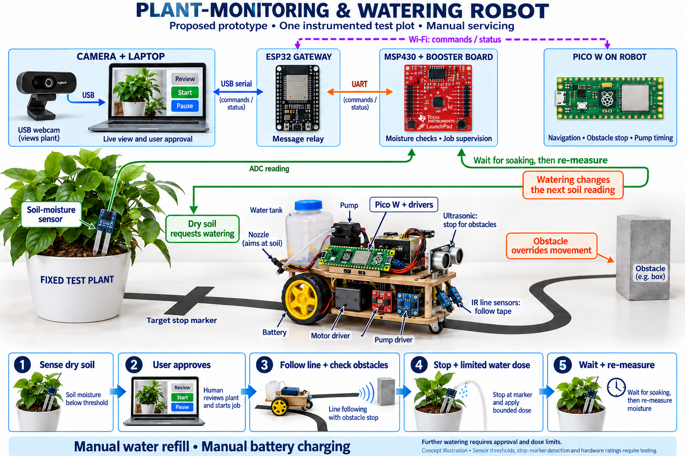
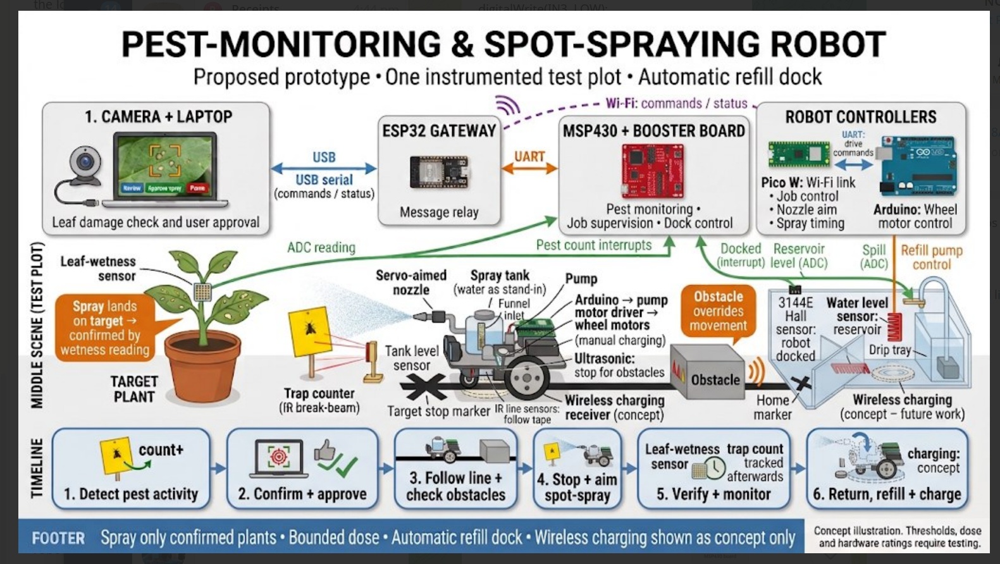

# Project diagrams

Start with the current placement diagram. Older images are included as design
history and can show features or board roles that have since changed.

## Current board placement

[Detailed placement and mounting notes](../../Wireless_Link/board-placement.md)

These are role/placement diagrams, not power schematics. Only the wireless LED
bench link is integrated between the radio boards. See [wiring](../wiring.md)
for known pins and unassigned interfaces.

## Intended project workflow — not yet implemented end to end

Sensor thresholds, target confirmation, dose measurement and interlocks need
implementation and physical validation. An image alone is not proof of a pest
identity, and sending a pump command is not proof that liquid was delivered.

## Earlier concept illustrations

### Plant-monitoring and watering concept

This earlier plan used a fixed MSP430 and Pico motor control. The current design
puts the main MSP430 on the robot and gives wheel control to the Uno.

[Original generation prompt](../../output/diagrams/plant-care-robot-concept.prompt.txt)

### Pest-monitoring and spot-spraying concept

This supplied concept predates the two-MSP430 placement decision. Dock, spill
detection, aimed nozzle and charging details in the image are proposals, not
features demonstrated by Version 1.

### Earlier setup PDF

[Plant-care robot setup guide](../../output/pdf/plant-care-robot-setup-guide.pdf)
and its [source generator](../../output/setup/build_robot_setup.py) are retained
from the early concept stage. Use current sketch READMEs and wiring notes for
the latest assignments.

## Screenshot gallery

- [Dashboard with real MSP430 bench readings](../../output/verification/dashboard-live.png)
- [Mobile dashboard](../../output/verification/dashboard-mobile.png)
- [Initial dashboard](../../output/verification/dashboard-initial.png)
- [Mobile review screenshot](../../output/verification/dashboard-mobile-review.png)

All diagram/image files available in the project workspace are retained. Some
earlier chat diagrams existed only as temporary clipboard files that are no
longer on disk; they are not represented here as recovered originals. The live
Canva deck is also not bundled as an export in this release.
